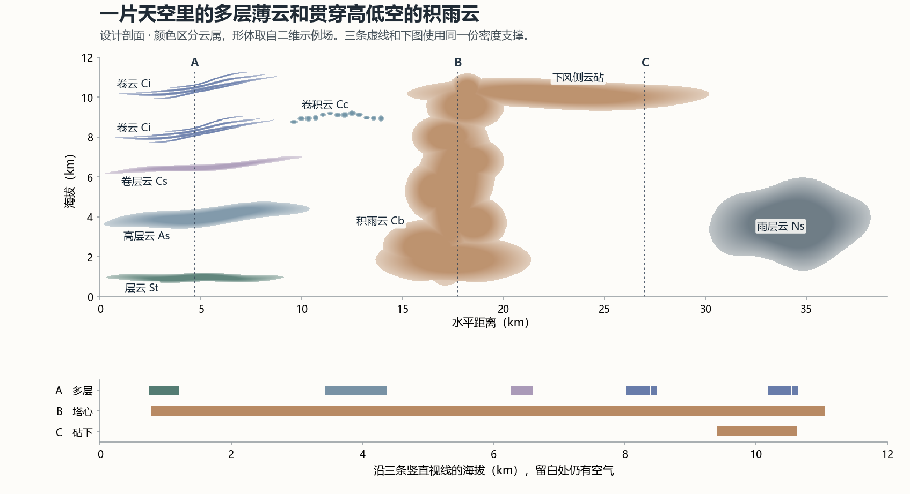
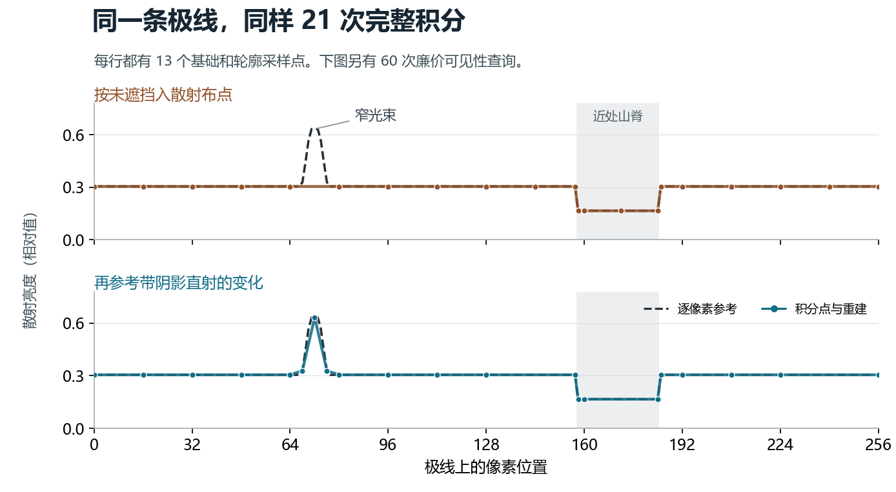
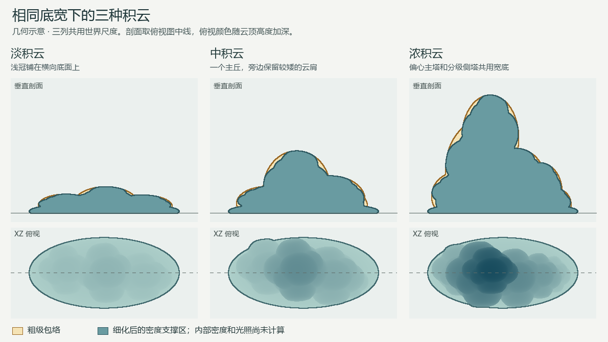

# Atmosphere, Sky, and Clouds

Alpha Piscium separates low-frequency LUTs, view-dependent sky-view/epipolar data, volumetric clouds, and final local
composition. Atmosphere preparation runs in `begin` and clouds render early in composite. Air/water resolve after
GI history fix, alongside spatial blur passes when enabled, and finish before translucency.

## Code map

| Path | Responsibility |
| --- | --- |
| [`shaders/techniques/atmospherics/air/lut/`](../../shaders/techniques/atmospherics/air/lut/) | Atmosphere LUT generation and API |
| [`atmospherics/air/Raymarching*.glsl`](../../shaders/techniques/atmospherics/air/) | Air-medium ray marching |
| [`SliceEndPoints.comp.glsl`](../../shaders/techniques/atmospherics/air/SliceEndPoints.comp.glsl) | Epipolar slice endpoints |
| [`EpipolarScattering.comp.glsl`](../../shaders/techniques/atmospherics/air/EpipolarScattering.comp.glsl) | Air epipolar-scattering kernel |
| [`Cumulus.glsl`](../../shaders/techniques/atmospherics/clouds/Cumulus.glsl), [`Cirrus.glsl`](../../shaders/techniques/atmospherics/clouds/Cirrus.glsl), [`Mediums.glsl`](../../shaders/techniques/atmospherics/clouds/Mediums.glsl) | Cloud density, media, and phase functions |
| [`RenderVolumetric.comp.glsl`](../../shaders/techniques/atmospherics/clouds/RenderVolumetric.comp.glsl) | Main low-cloud render |
| [`Accum.comp.glsl`](../../shaders/techniques/atmospherics/clouds/ss/Accum.comp.glsl) | Temporal/spatial cloud accumulation and upscale |
| [`atmospherics/clouds/amblut/`](../../shaders/techniques/atmospherics/clouds/amblut/) | Cloud ambient-light LUT sampling and gathering |
| [`SkyComposite.glsl`](../../shaders/techniques/atmospherics/SkyComposite.glsl), [`LocalComposite.glsl`](../../shaders/techniques/atmospherics/LocalComposite.glsl) | Shared sky and local-volume composition |
| [`shaders/util/Celestial.glsl`](../../shaders/util/Celestial.glsl) | Project sun, moon, star-map, and constellation logic |

## Begin: LUT and frame preparation

The LUT update sequence follows these dependencies.

| Order | Pass | Purpose |
| --- | --- | --- |
| 1 | [`GenerateTransmittance`](../../shaders/techniques/atmospherics/air/lut/GenerateTransmittance.comp.glsl) | Updates the 256×64 `persistent_transmittanceLUT` |
| 2 | [`SliceEndPoints`](../../shaders/techniques/atmospherics/air/SliceEndPoints.comp.glsl) | Updates epipolar geometry for the frame |
| 3 | [`GenerateMultiSctr`](../../shaders/techniques/atmospherics/air/lut/GenerateMultiSctr.comp.glsl) | Updates the 32×32 `persistent_multiSctrLUT` |
| 4 | [`clouds/amblut/Sample`](../../shaders/techniques/atmospherics/clouds/amblut/Sample.comp.glsl) | Samples previous/current cloud ambient information |
| 5 | [`GenerateSkyViewLUT`](../../shaders/techniques/atmospherics/air/lut/GenerateSkyViewLUT.comp.glsl) | Writes `uimg_skyViewLUT` |
| 6 | [`clouds/amblut/Gather`](../../shaders/techniques/atmospherics/clouds/amblut/Gather.comp.glsl) | Writes the 32×192 `persistent_cloudsAmbLUT` |

Fixed LUT dimensions are declared in [`shaders/shadesmith.json`](../../shaders/shadesmith.json);
screen-sized/configurable images are declared in [`scripts/shaders.properties`](../../scripts/shaders.properties).

Both `uimg_skyViewLUT` dimensions use `SETTING_SKYVIEW_RES`. The fixed `persistent_epipolarData` tile is 2048×3073.
`SETTING_EPIPOLAR_SLICES` selects the active width, and `SETTING_SLICE_SAMPLES` selects a logical height of
385, 769, 1537, or 3073 for three layers plus the endpoints row. When adding a sample count,
check the tile capacity, dispatch, and indexing in [the epipolar code](../../shaders/techniques/atmospherics/air/).

## Cloud passes

The [cumulus silhouette and LOD revision](#积云轮廓与细节层级修订) is the geometry baseline for [lighting comparisons](#两项光照实验如何跟进云形) and the [next two cloud genera](#层积云与高积云的建模交付).
The [shared cloud field](#十种云共用的世界体积) also covers cirrus, sheets and deep convection. Its [composition rules](#多层云与大气雾和水的合成) apply to terrain, the sky and rays leaving a water surface.
The [cloud-lighting experiment](#云光照的物理对照) uses the same density for its real-time candidate and transport reference.

When `SETTING_CLOUDS_CU` is enabled:

| Order | Pass | Purpose |
| --- | --- | --- |
| 1 | [`RenderVolumetric`](../../shaders/techniques/atmospherics/clouds/RenderVolumetric.comp.glsl) | Ray marches cumulus using the ambient LUT, atmosphere LUTs, shadows/lights, and project cloud noise |
| 2 | [`clouds/ss/Accum`](../../shaders/techniques/atmospherics/clouds/ss/Accum.comp.glsl) | Applies history accumulation, confidence/variance processing, and upscaling to the low-resolution result; this is the [`ss/Accum`](../../shaders/techniques/atmospherics/clouds/ss/Accum.comp.glsl) stage |
| 3 | Later air/local composition | Reads the accumulated cloud scattering and transmittance |

The main screen tiles are `transient_lowCloudRender`, `transient_lowCloudAccumulated`, and `history_lowCloud` (
RGBA32UI). The hand-maintained property fragment declares custom cloud phase-LUT, cirrus, cumulus base/detail, and curl
textures. High cirrus is sampled by the shared sky/cloud path rather than a separate compute program.

### Cumulus isotropic multiple scattering

The cumulus renderer reuses the existing ordered eight-sample sun-light column. For each source sample jittered uniformly in distance within its quadratic-distance bin,
let `U_i` be the prefix optical depth from the start of the light column to that source position, `sigma_s` the scattering coefficient,
`sigma_tr` the transport coefficient, `ds` the sample length, and `r` the source radius. This diffusion approximation
uses `sigma_tr ≈ sigma_t` in the implementation. With dimensionless absorption fraction (albedo deficit) `a = 0.001`
multiplying optical depth, per-channel asymmetry `g`, and `k = sqrt(3a)`, the direct upstream-prefix estimator is

$$
W_i=\frac{(\sigma_s\,ds)\sigma_{tr}}{r},\qquad
\Phi=\sum_{i=1}^{8}W_i e^{-aU_i}
     \left(1-e^{-(1-g)U_i}\right)e^{-kU_i}.
$$

The implementation clamps the build rate `1 - g` to a nonnegative value so transformed color spaces cannot turn
scattering buildup into amplification.

Intensity is applied before a fixed soft compression:

$$
\Phi_{\mathrm{mapped}}=1-e^{-\max(\mathrm{intensity}\,\Phi,0)}.
$$

This bounds each mapped channel below `1`. `SETTING_CLOUDS_CU_ISOTROPIC_MS_INTENSITY` supplies `intensity`; `0`
disables the contribution, the default `1.0` is the current artistic gain, and `0.25` approximately matches the
omitted `3/(4π)` normalization reference. The result is added independently of the existing WDT22
multiple-scattering term; it does not replace or modify that term.

The accumulated `phi_fwd` field is isotropic and follows the prefix estimator, but final view-path readout intentionally
uses `msPhase = mix(UNIFORM_PHASE, layerParam.medium.phase, 0.7)` to retain controlled directional structure. This
rendering choice is layered after the isotropic field, not part of its transport recurrence.

The receiver-local boundary weight is

$$
H(x,z)=\mathrm{thickness}\;\mathrm{saturate}(\mathrm{baseCoverage}_{raw}(x,z)),\qquad
\Delta=\mathrm{clamp}(0.05/\_LOW\_BASE\_FREQ,0.025,0.2),
$$

$$
\partial_xH=\frac{H(x+\Delta,z)-H(x-\Delta,z)}{2\Delta},\qquad
\partial_zH=\frac{H(x,z+\Delta)-H(x,z-\Delta)}{2\Delta},\qquad
N=\mathrm{normalize}(-\partial_xH,1,-\partial_zH),
$$

$$
C_{top}^{raw}=\mathrm{saturate}\!\left(\frac{N\cdot\mathrm{renderParams.lightDir}+0.5}{1.5}\right),\qquad
C_{top}=\mathrm{mix}(1,C_{top}^{raw},0.25),\qquad
C_{bottom}=1-\exp\!\left(-\frac{\max(h_{local},0)}{0.1\,\mathrm{mix}(1,4,h_{column})}\right),\qquad
B_{eff}=C_{top}C_{bottom}.
$$

Here `baseCoverage_raw` is the existing pre-height coverage value, `h_column = saturate(baseCoverage_raw)` reuses the
receiver density lookup, and `h_local` is the normalized receiver height (`0` at the cumulus-layer base and `1` at its
top). The constants correspond to `b = 0`, `p = 1`, and `H_bottom = 0.1`, matching the density model's existing normalized
`0.1` bottom scale. `C_top` uses the actual `renderParams.lightDir`, not the cone-jittered light-march direction. The
`0.25` confidence strength keeps the top factor in `[0.75,1]`; full-strength use of the coarse coverage normal exposes
vertical bands in the cloud body. The gate is evaluated once per occupied receiver sample and multiplies every source
weight before accumulation, intensity, and compression. It costs four extra coverage-proxy evaluations with no extra
center lookup, and adds no pass, resource, texture resource, or density march.

The estimator is adapted from AshenOneArt's [HanPi Volume Cloud implementation](https://github.com/AshenOneArt/HPVolumeCloud/blob/27e799914493de9fa527179312ed72a39d08e225/VolumetricClouds.hlsl)
and [forward-flux derivation](https://github.com/AshenOneArt/HPVolumeCloud/blob/27e799914493de9fa527179312ed72a39d08e225/Docs/PhiFwd_FromRTE.md).

## Air, depth layers, and composition

| Stage | Pass/code | Purpose |
| --- | --- | --- |
| GI phase | [`GIDenoiserEdgeClassificationAndVolumetricsDepthLayers`](../../shaders/pass/composite/GIDenoiserEdgeClassificationAndVolumetricsDepthLayers.comp.glsl) | Builds the depth layers required by volumetrics |
| Air volume | [`EpipolarScatteringAir`](../../shaders/pass/composite/EpipolarScatteringAir.comp.glsl) | Consumes endpoints, epipolar data, LUTs, shadows, and depth layers to produce air scattering |
| Water/translucency | [`LocalComposite.glsl`](../../shaders/techniques/atmospherics/LocalComposite.glsl) | Reconstructs one air or water interval from epipolar samples for the translucent back and final composites |
| Optional correction | [`VolumetricLocalCompositeBreakFix`](../../shaders/pass/composite/VolumetricLocalCompositeBreakFix.comp.glsl) | Corrects depth breaks at the end |

### 天空、雾与水的分段合成

下列推导给出区间结果的含义。各云属如何共用它、卷云旧入口如何退出，以及多层云与水面的复核镜位，见[多层云与大气、雾和水的合成](#多层云与大气雾和水的合成)。

主检出 `9e82f4565` 有两套含义不同的“层”。Sky View 的第 0 组从阴影距离之后积分晴空，供 GI 和部分反射、折射查询。第 1–3 组按积云中高和卷云高度分割空气，主天空在这些组之间插入整段积云和卷云。积云历史只存散射、透射和历史长度，实体像素走不到这条天空合成路径。另一套由水面、其他透明表面和实体深度生成，远到近的三个槽位分别交给空气、水、空气。两套层没有共同的沿射线距离边界。[Sky View 生成](../../shaders/techniques/atmospherics/air/lut/GenerateSkyViewLUT.comp.glsl) · [天空合成](../../shaders/techniques/atmospherics/SkyComposite.glsl) · [透明深度分段](../../shaders/techniques/atmospherics/VolumetricsDepthLayers.glsl)

推荐保留现有 `ScatteringResult`。在给定起点、方向和世界米制区间内，返回段内朝观察者散入的 RGB 辉度 $S$ 和 RGB 透射 $T$。近段和远段串接得到 $S_n+T_n S_f$ 与 $T_nT_f$，最后给背景乘总透射。天空以行星或大气边界为终点，远山以实体深度为终点。日月盘与星空作为边界辐亮度。先将视深转为沿该射线的实长，再把端点变换到大气坐标。现有水平距离和高度缩放可以不同。[现有合成运算](../../shaders/techniques/atmospherics/Common.glsl) · [大气坐标换算](../../shaders/techniques/atmospherics/air/Common.glsl)

**空气和雾。** 主检出的空气包含 Rayleigh、Mie 和臭氧，近处体积光另查主光阴影。在一条无遮挡的天空射线上，高度层可从眼点开始，epipolar 又会计算到阴影距离的近段。两边都输出了这段空气的散射与透射。建议近场由 epipolar 或实际区间积分给出一次，远场从同一个交接点算到地形或天空。`shadowDistance` 只约束地形阴影采样。远处仍有空气透视，云隙光用所在位置到太阳的云透射。若加入局部地雾，则在重叠区间把额外雾的消光和带自身光照的散射源加到空气里，用共同透射积分。同一批气溶胶的密度只计一次。[近场空气](../../shaders/techniques/atmospherics/air/RaymarchScreenViewAtmosphere.glsl) · [EGSR 2020 的天空与空气透视](https://diglib.eg.org/items/8a3e5350-18b3-46bd-9274-3add5af88c75)

**云和空气共处的距离。** 浓云采用标量云消光，保留彩色入射光与云前空气透视。已有实验给出了省去每个细步长都查大气的做法。对单个空气区间，以近端为 0、长度为 $D$，记 $S_a(s),T_a(s)$ 为该段空气和雾累计到 $s$ 的结果。它们可包含云投在空气上的太阳阴影，观察路径上的云消光则由 $T_c(s)$ 单独处理。$Q_c$ 是云散射源除以云消光，在有云的点取值。按 $d\alpha_c=T_c(s)\sigma_{t,c}(s)\,ds$ 加权可得

$$
S_{ac}=T_c(D) S_a(D)+\int_0^D [S_a(s)+T_a(s)Q_c(s)]\,d\alpha_c(s),\qquad T_{ac}=T_a(D)T_c(D).
$$

云细步本来就算出了权重 $T_{c,\mathrm{near}}(1-e^{-\Delta\tau_c})$。可以按它选少量散射深度，再查到这些位置的空气。每个被水面、玻璃或实体截断的区间单独累计。薄云、擦边或隔着净空的两团云应保留分开的深度贡献。举例，近、远云透射分别为 0.2 和 0.8，交换次序后整段云透射都是 0.16。夹在中间的雾若向相机散入 0.4，其可见贡献却是 0.08 或 0.32。单一平均云深可以帮助历史重投影，但不能恢复这个差别。已有的推导、均匀介质校验和 GLSL 取样实现分别见 `c09cfdc76:docs/en/modules/atmosphere-clouds.md`、`c09cfdc76:scripts/test/cloud-local-transport-check.py` 的 `air_cloud_integral` 和该修订的 `RenderVolumetric.comp.glsl`。[体积输运方程](https://pbr-book.org/4ed/Light_Transport_II_Volume_Rendering/The_Equation_of_Transfer)

**如何供应距离查询。** 旧云实验返回给背景的是上式的积分项和 $T_c$，预期背景已经带有该段空气。建议在交给通用合成前就补入 $T_c S_a(D)$，并将该段透射写成 $T_a(D)T_c(D)$，让后面的水面和地形直接消费完整区间。第一版可只给实际端点和少量云深提供空气结果。沿相机射线缓存累计值时，只在同一条直线、同一介质范围且近端透射仍可分辨时恢复子段。透射接近零时，从可见的新起点直接求段，或在前景已遮蔽背景时终止。低分辨率的全球方向查询继续给 GI 和水面提供远方天空。在近云旁的反射或折射要从表面起点沿新方向查询局部段，再接远场天空。每次拼接只接入尚未覆盖的距离。

**水面和玻璃。** 首先求从界面看出去的反射与折射分支，各按自己的方向和介质累积。用现有 Fresnel、表面材质和高光合成，最后应用眼点到界面的前景段一次。岸上看湖时，反射分支走空气和云雾，透进湖底的分支走水。水下向上时，折射出水的分支查询空气与天空，全反射的分支留在水里，两者都经过同一段眼前水体。现有 SST 命中读的是从另一个屏幕像素看过去、已带一部分体积的背景。可共用的后景段只取一次，路径差异明显时应以命中点的表面辐亮度为边界补算界面到命中的介质。水的 RGB 消光、散射与焦散沿用现有求值。最前层的深度断裂修正也应重算原来失败的区间，现行补算使用眼点到实体的空气段。[水体输运](../../shaders/techniques/atmospherics/water/WaterEpipolarScattering.comp.glsl) · [SST](../../shaders/pass/composite/TranslucentSST.glsl) · [最终表面合成](../../shaders/pass/composite/TranslucentComposite.glsl) · [深度断裂修正](../../shaders/pass/composite/VolumetricLocalCompositeBreakFix.comp.glsl)

用户确认首版覆盖一段连续水体，包括从岸上看入水中、穿过水面和从水下抬头看云。沿用现有近、远水深和眼点介质标记。水下起段取眼点，终点取出水界面或先命中的实体。视线上隔着空气的第二段水体留给需要额外出入界面的后续版本。

接入时先用无云天空与远山检查近远交接处，再在两团云之间放一段可见薄雾并移动地形截断深度。水面在同一天空下由上、下两侧观察，连续跨越水线并比较屏内命中和屏外方向。首版所有体积改动沿用同场景整帧 1.30 倍上限。

## Sky and celestial rendering

Vanilla clouds, sun, moon, sky, and stars are disabled in the project property fragment. Alpha Piscium renders them
through its own sky composite and [`Celestial.glsl`](../../shaders/util/Celestial.glsl), conditionally binding
`usam_starmap` only when star intensity is nonzero and `usam_constellations` only when its setting is enabled.

## Settings

| Category | Settings |
| --- | --- |
| Atmosphere scale/ground | Altitude, density scale, and ground albedo |
| Air | Epipolar slices/samples; Mie turbidity/time curve; Mie/Rayleigh/ozone multipliers |
| Sky/light shafts | Sky-view resolution, sky samples, shaft samples/shadow samples, depth-break correction, and softness |
| Low cloud | Upscale factor; history length/confidence/variance; minimum/maximum steps; height/thickness/density/coverage/phase; isotropic multiple-scattering intensity; wind; and shape frequencies |
| High cloud | Cirrus height, density, coverage, and phase |
| Celestial | Sun/moon radius, distance, temperature/color/albedo; star-map intensity/gamma/bright-star boost; and constellations |

All settings are declared in [`scripts/options.main.kts`](../../scripts/options.main.kts); profiles mainly scale
epipolar resolution, cloud upscale, history length, and march steps.

## Maintenance invariants

- Change LUT coordinate conventions and every API consumer together.
- Keep epipolar counts within the declared size mapping.
- Keep cloud-history render resolution, upscale factor, jitter, and confidence logic aligned.
- Change binary assets, `customTexture.*` declarations, and samplers together.
- Test the full day cycle, weather, water transitions, fast turns, both sides of cloud layers, and history resets.

## 程序化云的水平分布、垂直结构与保守边界

实拍编号对应主检出本地的 `agent_inputs/cloud-references/index.html`。地面全景适合判断云区交界和遮挡次序，侧视适合判断同一云体的底宽与塔冠，斜俯视适合判断连通性和云隙。绝对高度和间距按世界尺度试摆。

### 首版建模交付

本次授权在正常 Iris 云渲染路径中实现程序化云形。优先让淡、中、浓积云出现在同一片可飞入的天空，保留现有高云的天空合成。世界 XZ 的云区决定成团方向、蓝隙和凝结底高，同一 XZ 可以有多段云和层间净空。形状按 1 方块 = 1 米求值。相机、太阳透射和屏幕外采样在同一位置和游戏时刻应读到同一云场。继续使用现有光照完成形状接入。新光照的[输运对照](#云光照的物理对照)可独立推进。游戏晴雨驱动与云团生成消散留待后续。

每一层细节经过形变、侵蚀与过滤后仍须包含在当前父包络内。整团随风运动，局部可升腾、偏移。重载光影或重进存档时，相同世界位置、游戏时刻与设置应得到相同云形。底宽、塔高、瓣数、噪声与 LOD 细节交给实现者按实拍试调。用户选中的动画构图是 `anime-sky-01` 和 `anime-sky-03`，实拍是 `SKY-031`、`SKY-032`、`SKY-106` 和 `Cu-ref-02/03/05/07/09/10`。整幅图可用于观察主次、蓝隙、宽底和偏塔，具体云团的位置、高矮和数目允许变化。跨检出查看时从主检出的 `agent_inputs/cloud-references/` 打开图库。

交付以可运行的 shader 和同场景对照为准。用开阔地环视、绕塔飞近、穿云及云上俯视检查三种积云的轮廓与遮挡。用透射图核对塔间和层间的空隙，在动画与远近 LOD 交替处核对保守边界。在固定游戏时刻重载，比较云形。按相同场景、分辨率和设置对照改动前后的整帧 GPU 时间，首版上限为原来的 1.30 倍，同时记录云相关 pass 以便定位开销。实现、实机对照和可恢复的修正可连续推进，遇到影响美术目标、支持范围或帧时间上限的取舍时交回设计讨论。

### 积云轮廓与细节层级修订

接续 `procedural-cloud-shapes` 已接收的首版。用户认可这次云形的改善并授权继续推进。实现起点是原云形分支 `codex/procedural-cloud-shapes` 上的 `033741ccc`，对应的 Iris 实机记录在 `3a09d43af`。沿用该执行会话和实验检出。淡积云薄肩已经局部断开，浓积云已能分出塔腰和高低不同的冠瓣。下一轮集中在以下两处。

- **云底与云瓣。** 从 `ground-180` 右侧浅云的平行亮边入手。沿用同镜位的彩色原图和云透射，配合同一朵云换角度或单独显示父团，定位是哪段云体造成的。前后云团真实叠置形成的边应保留。对同一团上反复出现的整齐底边和圆瓣，依照 Cu-hum-01、Cu-hum-03 调整浅肩厚度、疏密和云瓣之间的缺口，使部分背风薄肩出现断续碎絮，保住云芯和局部平坦的凝结底。若彩色亮边只由光照或重建产生，保留对应透射和镜位，交给该环节处理。用 `ground-0` 和绕塔侧视核对中、浓积云的根、腰和冠部仍有各自的体量。本机对照图位于 `agent_inputs/cloud-references/experiments/2026-11-cumulus/06-iris-same-pose.png`。[首版同镜位实机记录](https://github.com/Luna5ama/Alpha-Piscium/blob/3a09d43aff0cfd8317093b219ed80940003809ec/docs/rendering/atmosphere-clouds.md)
- **细节只向内侵蚀。** 在同一世界位置、游戏时刻和设置下，每个更细 LOD 的正密度区域须包含在相邻粗级之内，过渡档也要成立。云芯和薄边的密度值可随过滤变化。`033741ccc` 已在未扭曲坐标上裁父包络，但碎絮侵蚀在近处取 `(1 - wisp) * 0.025`，远处取 `0.018`，两项大小会互换。沿用已有场和纹理即可，例如让粗级确定支撑、细级再减去非负侵蚀。粗级还要保住可辨的蓝隙和层间净空。空区继续用有保守界的几何跳过，包络内积分标量密度。交付时给出包含关系为何成立，并在动画、轮廓和 LOD 过渡处用实际场值复核。

交付使用相同种子、游戏时刻、光照和曝光，把 `033741ccc` 与候选在上述 Iris 镜位的彩色原图及对应云透射并排，再看一朵调参时没用过的云。复用首版穿云、云上和固定时刻重载证据，仅复测受改动影响的路径。性能沿用 `cloud-6-720p` 同设置和原始基线 `853214567`，整帧上限仍为其 1.30 倍，另记录受影响的积云 pass。已有实机原件见运行 `c34c098d-766d-4cf5-aac6-dee89f00ee62` 的 `iris-comparison.png` 和 `measurements.json`。原执行者可自主迭代直至交付对照，影响美术方向、云种范围或帧时间上限的取舍再交回讨论。

`8e09035ce7b8dc4287d5308b78e206c2245c1bc4` 已在实验分支通过本轮验收。479,232 个位置未发现相邻 LOD 支撑反例。固定曝光的四个实机镜位覆盖前后浅云、近塔、中远塔和留出云。浅云瓣间透射从 0.940 增至 0.999，重叠处由 0.0443 降至 0.00248。原始基线和候选在 720p 的整帧 GPU 时间为 12.616 和 13.490 ms。复现入口为云形分支的 `33c3e618f:docs/rendering/atmosphere-clouds.md` 及运行 `223b78f9-00fc-4e76-822f-51ddac29b3ef`。

### 层积云与高积云的建模交付

下一个实验交给原云形建模会话，从 `8e09035ce` 的世界云场扩展到**层积云（Sc）及液态高积云（Ac）的层状形态**。在有限 XZ 云区中塑出有厚度的云片。层积云参考 Sc-01、Sc-02、Sc-07 的相连大块、云卷与俯视缺口；高积云参考 Ac-01、Ac-03、Ac-07 的成片小块、波列与片间透光。自摄 SKY-033 和 SKY-200 用来比对大片蓝天如何夹在疏密不同的云区之间。局部底高、厚度、云块间距和连通性分别可变，使同一片天空能出现近处较厚的云卷、中层断开的云片，以及其间的空气。具体尺度与形状构造由建模者对照片试调。本机实拍选样（`agent_inputs/cloud-references/index.html`） · [WMO 层积云](https://cloudatlas.wmo.int/en/stratocumulus-sc.html) · [WMO 高积云](https://cloudatlas.wmo.int/en/clouds-genera-altocumulus.html)

沿用一方块一米、固定世界和时间可重建的动画、逐级向内侵蚀、保守跳空和世界位置标量密度。主视线、太阳和屏幕外查询要读到相同的云。先交一组可复现的混合天空，用地面广角、层间视角和云上俯视对照实拍，并检查穿层时的厚度、云隙以及与积云的前后遮挡。交付同时留下光照两线可取用的形状提交、种子、时刻、区域与相机，以及可比对的透射。用同一混合场景切换新增云场量出增量；沿用 `cloud-6-720p` 和 `853214567` 核对合计整帧 1.30 倍上限。其余云型的形状路线见下节，游戏天气仍按既定顺序后续接入。

### 十种云共用的世界体积

已定设计覆盖 Cu、Sc、Ac 及下表七属。以一方块一米、海平面为垂直基准，用世界格、区域种子和游戏时刻重建云体。每个云体有自己的水平范围、随 XZ 起伏的底和顶、形态参数与风位移。同一云属可在同一 XZ 上出现多次，云体也能跨越多个高度带。温带的低层（地面至约 2 km）、中层（约 2–7 km）和高层（约 5–13 km）用作布置偏好。中高层本来就有重叠。积雨云常由低空长入高空，雨层云也可占据多个高度带。实际底顶由局部云区决定，天空按玩家所在的世界位置截取。原有晴天空的中远浓积云构图仍以浓积云为主体，积雨云单独随深对流区出现。[WMO 高度带及跨层云](https://cloudatlas.wmo.int/en/useful-concepts.html)

**云场提供两种查询。** 射线查询从任意世界起点，在给定的米制区间内按由近到远返回下一段可能有云的范围或安全空距。点查询在同一位置、时刻、LOD 返回局部凝结物造成的标量消光，单位为每米，区分液滴与冰晶。沿用现有格子遍历、形体与纹理，按密度支撑的实际底顶筛选附近云体。大云幕和长砧从覆盖的每个空间格都须可找到同一个生成者，例如以含全部姿态的最大伸展推导邻格查询半径。临时分段可以分块续走，光路中途遇到更多云仍继续处理。掠射、从云内起步和向下看都沿同一规则。一个屏幕外的太阳、反射或 GI 查询也从它自己的起点开始。

横跨一个空间格时枚举本格和包络能伸入的邻格，以生成格和格内序号识别云体。碰到下一格面就重新纳入候选，已证明的空距最多用到当前候选覆盖的边界。从包络内起步时从零距离开始，近水平视线按侧面的进出点处理。区域种子先确定湿润程度、凝结底、可发展厚度与风切变，据此生成当地适合的云体组合。中空或高空的局部候选也可单独出现。

**形体和重叠。** 粗级只用已知保守的有限包络求交或跳空。将薄片包在该片区上下表面的起伏极值内，将弯曲纤维包在一串覆盖其弯度和半径的胶囊内，将积雨云分成塔体和云砧等可分别筛选的包络。实际密度在未扭曲的父域内裁边，细 LOD 只向内侵蚀。形变跟随整个云体，动画的横移、上升与局部摆动都计入候选范围。同一批凝结物的云瓣、跨格副本和由液相过渡到冰相的塔顶归同一云体求值一次。共形子瓣可取裁剪后密度的最大值。真正独立且在同一点共存的粒子群按单位长度相加。若将云体消光拆成液滴和冰晶两份，冰相权重表示消光份额，两份之和等于原总消光。积雨云可沿局部上升枝从较暖的水云区连续过渡到混合区和以冰为主的高空云砧，过渡高度随云区而变。光照按各自散射系数与相函数计算，入射日光、天光及最终散射结果保留颜色。冰晶相函数和日月晕留给冰云光照验证。[WMO 积雨云成分](https://cloudatlas.wmo.int/en/physical-constitution-cumulonimbus.html) · [WMO 卷积云成分](https://cloudatlas.wmo.int/en/physical-constitution-cirrocumulus.html)

| 云属与实拍锚点 | 世界空间里的形状 | 验形时应看到什么 |
| --- | --- | --- |
| 卷云 Ci · Ci-03、Ci-05、自摄 SKY-051/055 | 在有限的风带里生成数束三维弯曲纤维，束内有主轴、分枝和渐细的末梢。每束有自己的起始高度、厚度和下垂量，风切变控制弯钩与羽尾。 | 地面看得到丝束间的蓝天。横穿能依次经过稀丝、稠束和净空。在两束之间仰视和俯视能分别找到它们。 |
| 层云 St · St-01、St-04、St-07 | 低处有限或彼此连片的浅云幕，云底缓慢起伏，云顶和边缘可独立变薄或局部撕开。 | 从下面看较均匀，侧面能辨出薄厚，飞到上面能看到平缓云顶。接触山坡时按真实地形深度截断。 |
| 高层云 As · As-01、As-03、As-07 | 以中层为主的宽云幕，底顶能倾斜，厚度有大尺度梯度，内部可有宽条纹或纤维。允许延伸入高层。 | 同片中较薄处尚能透见模糊日轮，较厚处逐渐遮蔽。斜视和俯视能分辨厚薄交界。 |
| 雨层云 Ns · Ns-01、Ns-03、Ns-04 | 从中层展宽并可向下、向上增厚的连续云身，低处可有独立碎云。云身厚到足以遮住太阳。降水幕位于云身之下，可另有支撑与消光。 | 从云下、云侧分别辨出主体、低碎云与降水区。主体可用固定区域种子出现。降水微物理、雨粒和游戏晴雨驱动留到天气工作。 |
| 卷层云 Cs · Cs-02、Cs-05、Cs-07 | 范围宽、光学厚度小但几何厚度非零的冰晶薄幕。局部可光滑或带同向浅纤维，片区边缘缓慢退薄。 | 大片天空透亮而连续。上下穿越能测到有限厚度，远处斜看会延长穿过的路径。照片中的晕用来识别云属。 |
| 卷积云 Cc · Cc-01、Cc-04、Cc-06 | 在有限高空片区内组织细小云粒或波纹，方向、间距、连通性沿云区缓变。薄带里允许有真空孔隙。 | 地面可见细碎浅纹，飞近能穿过独立云粒或缝隙。与较低的高积云同框时，从真实尺寸和距离得到两种视大小。 |
| 积雨云 Cb · Cb-01、Cb-03、Cb-06/07 | 同一个深对流系统内，由低处宽底、上升塔和侧塔向上延伸。成熟塔在局部平衡高度附近向下风侧横展成形，塔尖可局部冒出砧顶。早期只需显出开始变平滑的塔顶。 | 从塔心选一条贯通路径，低底到云砧的实际密度连续。从只受砧缘覆盖的位置向上看，砧下有清楚的净空。绕到另一侧仍可认出砧与母塔的连接。 |

照片编号可在本机选样目录（`agent_inputs/cloud-references/index.html`）按云属检索。高空冰云依照片的丝状、幕状和粒状区分。层云的平底、高层云的厚薄梯度与雨层云的深厚云身也独立控制。[WMO 卷云](https://cloudatlas.wmo.int/en/clouds-genera-cirrus.html) · [卷层云](https://cloudatlas.wmo.int/clouds-genera-cirrostratus.html) · [卷积云](https://cloudatlas.wmo.int/en/definition-cirrocumulus-cc.html) · [层云](https://cloudatlas.wmo.int/en/definition-stratus-st.html) · [高层云](https://cloudatlas.wmo.int/en/altostratus-as.html) · [雨层云](https://cloudatlas.wmo.int/en/nimbostratus-ns.html) · [积雨云](https://cloudatlas.wmo.int/en/clouds-genera-cumulonimbus.html)

**深对流的连接。** 先为主上升枝选凝结底、可达顶高和随高度偏移的轴线，沿轴布置宽度有变化、彼此搭接的塔段。云砧从主枝顶端发出，随离根距离扩展并逐渐变薄，侧塔也接入同一母体。给连接颈部保留正密度核心，再在外围侵蚀和冰化。验收看实际密度与透射，仅有包络相交还不足以证明塔与砧连通。仅砧缘覆盖的列只登记上方的有云区间。若有另一片过境的中云，它保有自己的种子、底顶与深度。

图中是专门并列七属的二维验形场，单位为 km。按 5 m 间隔检查，A 列中穿过层云、高层云、卷层云和两个高度的卷云束，纤维内部另有净空。B 列从约 0.77 到 11.06 km 连续有云。向下风侧移到 C 列，则只有约 9.41–10.63 km 有云。这几个数字用于复查拓扑，实际云区的底顶继续随位置变化。

### 多层云与大气、雾和水的合成

**相交区间。** 射线从眼点或反射、折射的新起点开始，以最近的实体、介质界面或天空边界限定实际长度。再用所有候选云体的进入、离开事件划出近到远的半开区间。包络重叠处在同一个步进中求活跃云体的实际密度。包络外可以跳过云采样，这段仍含空气或局部雾。地形落在塔内就积分到山体，云后仍有薄雾就接着积分。天空视线最后接日月星空等边界辐亮度。近场 epipolar 可提供带地形遮挡的空气散射，远场 LUT 或区间积分从它结束的位置接续。`shadowDistance` 限定地形阴影取样距离，云给空气投影则从受光点沿太阳方向查询整个相关云场。

每个实际区间返回现有 `ScatteringResult` 的散射辉度 $S$ 和透射 $T$。同一点共处的空气、额外雾、液滴和冰晶共用总消光，各自的散射源在同一入射照明下相加。相邻区间的结果为 $(S_n+T_n S_f,\ T_nT_f)$，最后将背景乘总透射。浓云内部可复用[按云不透明度选取深度的积分式](#天空雾与水的分段合成)，只在选中的深度查询前景空气。隔着净空的云团按其各自深度参与估计。只保留一个散射源样本时，各段要有正确的抽样概率与补偿。云的平均深度可供重投影。交换透射分别为 0.2、0.8 的两团云，总透射都是 0.16。若中间雾产生 0.4 的辉度，近云透射 0.2 或 0.8 时，雾对眼睛的贡献分别是 0.08 或 0.32。

**水面改变光路。** 首版仍处理一段连续水。眼在水下时，对出水点的折射方向求那一整条空气、雾和多层云的结果。反射方向留在水里，全反射时只取反射分支。岸上视角的水面倒影沿反射方向查世界云场。两支按现有表面 Fresnel 和材质合成，眼点到水面的共同前景只应用一次。GI 和水面可用低分辨率屏外远场。靠近薄云或雾时，从新的起点求近段，再接未覆盖的远段。SST 命中如已带另一条眼射线的雾，只复用光程相容的部分。这些端点和返回量允许沿用现有单段水深缓冲。[透明深度分段](../../shaders/techniques/atmospherics/VolumetricsDepthLayers.glsl) · [反射与折射](../../shaders/pass/composite/TranslucentSST.glsl) · [合成运算](../../shaders/techniques/atmospherics/Common.glsl)

**接入和开销。** 以建模分支 `33c3e618f` 为查找起点。`Cirrus.glsl` 还在指定高度的球面求单交点。`SkyRay.glsl` 与 `CumulusRay.glsl` 各有卷云插入逻辑。`GenerateSkyViewLUT.comp.glsl` 的部分空气组和云环境光查询仍引用固定卷云高度。接入体积卷云时在同次替换中更新这些消费者，以及视线累积、太阳透射、GI 和水面方向查询，让每段云和空气只贡献一次。保存 $(S,T)$ 的 LUT 切片仍可作为缓存，切片编号不决定云所在位置。

在局部包络内细采样。宽幕优先裁出有厚度的区间，窄丝用保守区间截步或在其覆盖处做子像素积分，防止一大步越过整束云。远处对像素足迹内覆盖率和透射进行过滤（透射平均为 $E[e^{-\tau}]$），保住透光缝及前后次序。当前低云的 50 km 跟踪范围也要与云体自身的底顶分开。使用远场近似时从同一交接距离接入方向相关的剩余云和空气。积雨云用塔、砧分界跳过厚包围盒里的大片净空，厚核心达到不透明阈值后可结束该视线。预算以同场景 720p 的原始 `853214567` 为基线，所有体积改动合计整帧最多 1.30 倍。另用薄云掠射、塔内与砧下三种镜位定位采样开销。

**设计核对。** 在图中三个竖直视线、从云上向下、从塔内到实体终点，以及两条斜视线上，将空气、局部雾、液滴和冰晶的分段常量直接积分，与按云不透明度重排的积分对照。使用最长 5 m 的段长和双精度，七条光路的 RGB 散射和透射最大绝对差为 $3.8\times10^{-15}$。另在 2 m 前景水段后按正入射 Fresnel 合成水内反射与出水观天，RGB 最大差为 $2.0\times10^{-15}$ 以内。这是数值与路径顺序的检查，Iris 的近似采样、重投影及合计帧耗仍需在目标版本实测。

**交付镜位。** 原建模会话在 Sc/Ac 的可运行场上接续，先交多层卷云与水面、远山的深度合成，再交三类云幕、粒状高云和跨高度积雨云。每组可独立看图。固定世界、时间和光照，检查地面、层间、云上俯视、沿纤维掠射和从水下看高云。共同对照包括给相邻云层之间加入薄雾并交换前后云、让前方山体截断远云、越过水面、从塔心飞到砧下，以及跨空间格后回到同一视点。比较参考透射、彩色结果和原生帧耗。两条光照实验按完成的可复现密度版本接入，液态云和含冰云分别标明已验证的光学模型。[光照批次约定](#两项光照实验如何跟进云形)

### 大气、雾与主光体积软阴影

**晴空与雾的输入。** 沿用 Rayleigh 散射、气溶胶散射与吸收、臭氧吸收及随时刻变化的浑浊度，在 EGSR 2020 式透射与多次散射 LUT 的基础上求晴空颜色、太阳周围的气溶胶光晕和远景薄霾。当前 Sky View 的纬度平方映射已经把纹素集中在水平线，经度均匀。可以在相同纹素数下对照围绕太阳方向和地平线都加密的映射，在无云日出、正午和太阳经过纹理接缝时，对照高采样参考中的光晕梯度和地平线轮廓。生成与从任意方向查询必须共用一对正逆映射。本轮使用已有薄霾。可以走入、走出的局部低雾排在整套新云系统完成之后，当前仅做设计。届时由有限的世界区域、随 XZ 变化的米制底顶与平滑边缘给出额外雾滴密度，沿同一条视线累计散射和消光。低云延伸至地表时，同一批液滴只计一次。夹在两团云之间的雾仍可用作合成测试输入。局部光源向介质的散射列为后续范围。[现有空气系数](../../shaders/techniques/atmospherics/air/Constants.glsl) · [现有经纬映射](../../shaders/techniques/atmospherics/air/lut/Common.glsl) · [GT7 的太阳和地平线映射，幻灯片 181–182](https://s3.amazonaws.com/gran-turismo.com/pdi_publications/GDC2023_GT7_SKY_RENDERING.pdf#page=182)

**极线解决采样位置，半影取决于光源可见范围。** 当前空气 pass 在每条极线上等距布点，预取一排抖动过的 RTWSM 深度。抖动半径由设置和投影比例给定，与受光点离遮挡物的距离无关。空气读取水的 softness，水读取空气的 softness。表面阴影已有二维遮挡深度搜索和比较过滤，体积点可借用它的米制深度换算与逐点 warp，表面法线偏移、次表面散射和材质项只适用于表面。[极线布点](../../shaders/techniques/atmospherics/air/EpipolarScattering.comp.glsl) · [空气阴影取样](../../shaders/techniques/atmospherics/air/RaymarchScreenViewAtmosphere.glsl) · [水下阴影取样](../../shaders/techniques/atmospherics/water/WaterEpipolarScattering.comp.glsl) · [表面遮挡搜索](../../shaders/pass/composite/ShadowSample.comp.glsl)

对一个体积采样点，直接入射光取太阳盘各方向辐亮度、大气光程透射、地形可见性和云透射的乘积，再按各介质向观察方向的相函数积分。直射阴影改变散射源，观察方向的透射继续由眼前路径上的消光决定。天光和多次散射已有各自的入射量。云透射从该体积点向太阳算，云下、两层之间、云内和云上都按实际剩余光程查询。直接沿光线积分各类云的消光可作参考。若要缓存，保留沿光方向随深度变化的透射，供云自身光照和空气光束共用。接收点沿光线位于整列云的背光侧时，可以直接使用整列透射。盘面关联会影响结果。例如地形和云各只放过半个太阳，二者放过同一半时联合直射比例为 0.5，恰好相反时为零。分别平均后相乘，两种情况都会得到 0.25。在地形边缘与云影交叠处，用相同的盘面方向评估两者。若其中一个在整个盘面近似常量，则可提出积分。[深度相关的透射](https://doi.org/10.1145/344779.344958)

首个候选在极线上选少量需要实际积分的位置，查同一张主光 RTWSM 的二维邻域。设主光角半径为 $\alpha$，遮挡物与体积点沿光轴相距 $\Delta z$ 米。单一直边遮挡物在垂直于光轴的截面内，半影从全暗到全亮的宽度是 $2\Delta z\tan\alpha$。用估计的遮挡距离得出光空间半径，再把每个 tap 各自映射到扭曲的阴影图。对单个主导遮挡面，这是可实作的 PCSS 近似。RTWSM 只记录中心方向能看到的深度，枝叶重叠、前后两道栏杆以及盘上不同方向才露出的遮挡物，都要用独立的多方向几何参考判断误差。太阳盘的几何半径和抗混叠所需的纹素足迹分别处理。地形取样限于 RTWSM 实际覆盖，沿用现有重要性权重。[PCSS 的遮挡距离与平行面近似](https://developer.download.nvidia.com/shaderlibrary/docs/shadow_PCSS.pdf)

**对照范围。** 在默认太阳半径与日地距离下，角半径约 0.266°。直边后方 10、100、1000 m 的全半影分别约 0.093、0.930、9.301 m。`99c1ebdb` 将太阳盘边界改为照明所依据的角半径，默认角直径约 0.533°。原来的两倍放大用于旧光晕效果。光晕现由气溶胶相函数产生，遮挡参考使用光源的几何盘面。云中较宽的方向采样锥用于拟合散射和软影，其宽度是该近似的参数。阴影对照固定太阳照度和曝光。离线圆盘积分已核对直边宽度和半圆遮挡反例。把一条直边放在中央极线外 0.2 个采样半径处，中央线仍完全通光，整个圆盘的可见比例已降至 0.62647。实机比较均匀和自适应极线，使用同一太阳角、云形、浑浊度和曝光，查看树隙、云隙、山脊、日落近地平线与水面出入。另记录实际取样点、空气阴影与重建 pass 耗时，并按全体积合计整帧 1.30 倍上限取舍。[日盘与照度](../../shaders/util/Celestial.glsl) · [云光方向采样](../../shaders/techniques/atmospherics/clouds/RenderVolumetric.comp.glsl)

### 主光体积散射的自适应极线采样

**实施目标。** 在现有主光空气、薄霾与单段水的极线 pass 接入完整自适应流程。现在每个有效极线格点都做完整步进，重建时按前后深度加权，断层修正再算一次眼点到实体的空气。首版从带基础间距的样本开始，沿线检查深度与介质边界，标出必须积分的点及每个其余点可用的左右邻点。只在选中点求完整的有阴影散射，随后沿线插值、跨相邻极线还原屏幕像素。找不到相容邻点时，按该像素的介质和真实起止深度补算。同一规则可分别对空气和水的区间选点，各自使用已有光照与透射。反射与折射转向后按新区间查询。极线图集仍可保留规则寻址。地形阴影复用一张主光 RTWSM。[空气步进](../../shaders/techniques/atmospherics/air/EpipolarScattering.comp.glsl) · [沿线与跨线重建](../../shaders/techniques/atmospherics/air/UnwarpEpipolar.glsl) · [现有断层修正](../../shaders/pass/composite/VolumetricLocalCompositeBreakFix.comp.glsl)

**深度断层和光束分开判断。** 原始方案在深度断层两侧补点，Intel 后续实现也能按粗略的无阴影入散射之差细分。山脊从 100 m 跳到 18 m，改变的是可积分光程。先在足迹内识别这个界面，记录可共享的起止深度和介质，分别重建两侧。远处空气中穿过一束光时，几何深度可以处处一样。剩余完整积分应优先放在预计会把这束光插错的位置。大量近处轮廓出现时，单独统计边界及补算成本，并对缺少相容样本的局部范围直接积分。[原始自适应布点 §4.2](https://doi.org/10.1145/1730804.1730823) · [Intel 对无阴影入散射与深度判据的说明](https://www.intel.com/content/dam/develop/external/us/en/documents/outdoor-light-scattering-update.pdf)

首个增强候选比较同一段、同一眼光程消光下的无遮挡直射散射 $S_0$ 与有阴影直射散射 $S_d$。在少量探点估计遮挡损失 $R=S_0-S_d$，检查它与相容邻点插值的差，再决定哪里值得做完整步进。盘面方向上的地形可见性与该方向的云透射要共同进入估计。眼前透射、局部散射和相函数决定这次变化对画面的贡献。这样可以同时保留锥形光束的窄边和缓变区域的廉价重建。只查中心或只比较两端都会漏掉夹在探点间的细束。保留最大探点间隔，在邻近两条极线之间也检验足迹，尤其留意树缝、薄云开口和移出画面的太阳。若用历史来摊薄探测成本，水面出入、相机转动和移动遮挡时需验证当前区间和可见性。有限的软阴影仍由光源查询计算。

图为一维合成输入，257 个位置，地形深度为 100 m，像素 158–184 截到 18 m。从 30 m 起加入一条经均匀圆盘过滤的光缝，均匀介质的消光为 $0.01\ \mathrm{m^{-1}}$。两侧几何及基础样本共 13 点，每种方案都只做 21 次完整积分。无阴影判据在平坦区域平分最大间隔。第二种判据每四个像素另探可见性，按四分之一量化，有效查询共 60 次。把同一条光缝放在 64 个整像素位置，与逐像素解析参考比较，散射亮度的平均绝对误差由 0.00929 降到 0.00214。把更窄的亮缝放在所有探点之间时两种都漏检。这个例子隔离了细分信号，实际收益要计入探测、重建、补算和帧间稳定性的成本。

**实机交付。** 在相同阴影查询、云形版本、太阳角和曝光下，对照现有等距积分、原始自适应、增加遮挡判据三种情形。改变半影滤波时固定极线样本，单独核对遮挡距离变化造成的软硬过渡。以相同实际 GPU 时间比较山脊轮廓是否漏光、相同深度背景的光束峰值与半影宽度、慢速转动时的闪烁。覆盖地形树隙、云隙、穿云及入水出水，另看太阳在屏幕边缘与屏外。记录实际完整积分数、探测开销、重建与断层补算时间。以同一场景 720p 的原版整帧不超过 1.30 倍为总约束。完整自适应流程列为实施项，附加的遮挡判据以实测决定是否采用。在已接收的米制积云场上即可开始，后续云种沿共同的世界空间消光与透射查询接入。

### XZ 分布与垂直叠置

| 照片 | 可见特征 | 对生成器的约束 |
| --- | --- | --- |
| SKY-098、SKY-122 | 航拍中小塔断续成列，列内仍有缺口；另一些区域云块汇合，开口可以看见地面 | 分开控制云团中心的疏密、沿某方向的聚集倾向、单团足迹大小。三者共同决定覆盖率。 |
| SKY-033、SKY-200 | 全景里厚团、宽蓝隙和细碎云片相邻；另一张中数条云带近平行，其中一条由许多小块串成 | 给云斑、云带有限的水平范围和逐渐散开的边缘。允许带内断裂、同一片天空局部换形态。 |
| SKY-106、SKY-127 | 窗外的孤立塔高出较低云面；另一次航拍中，飞机上方是灰底，下方是能透见地面的云块 | 同一 XZ 可以有多个不连通的有云区间，层间净空必须可查询。塔基有时被前景挡住，不能据照片把它焊到前景云面。 |
| SKY-164、Cu-ref-02、Cu-ref-03 | 近处暗云挡住远方亮塔；另一组照片中几个塔头共用宽底、彼此高低错落 | 分别生成视线叠置和同体分枝。只凭亮度或图上的上下次序无法推断前后两块属于同一云体。 |

首版可在世界 XZ 上按种子重建有范围的云区。对流区由局部凝结底高、可发展厚度、聚集强度和带向控制。先用低频分布确定哪里聚团、哪里留空，再在区域内对带扰动的候选中心进行确定性筛选；沿带与横带使用不同相关长度即可得到断续云列。每个中心有独立的底宽与发展程度，邻近中心共享缓变的底高。高覆盖可以来自许多浅云，也可以来自少数连片的宽底。云塔可以孤立出现，也可局部聚成一列。厚度上限限制对流发展，实际塔顶由每簇上升枝决定。云区可叠置，不把一个地面坐标锁给一个云种。

默认水平和垂直尺度均为 1 方块 = 1 米。开阔平地转一圈，中远处至少要有一处能认出浓积云的轮廓，典型构图可读出一至三处，对流旺盛的方向也可以更多。一座孤塔、同一宽底上的几座塔头或远近搭接的两团都可以构成一处视觉重心。各处的大小和间隔应有差别，单独一个朝向可以留出很大一片蓝天。世界 XZ 上对流区的间距、范围与局部发展强度决定这幅构图。玩家的位置和朝向只用于观察。

本地图库 `agent_inputs/cloud-references/composition/index.html` 将四张动画截图中的六个局部与实拍并列。实拍 SKY-033 可看左侧厚团和右侧云片之间成片的蓝天，SKY-164 可看近处暗云的开口怎样框住远处宽塔和一串矮云头，SKY-183 可看几座细高云塔在开口中各自显出轮廓。首幅构图试取一组距海平面观察者水平 5 千米、底高 1 千米、顶高 3 千米的云塔，正侧面仰角约从 11° 到 31°。这些尺寸用于试摆，其他云区仍有各自的底高和可发展厚度。[当前高度与距离设置](../../scripts/options.main.kts)

云区可以包含独立过境的云幕，也可以包含到稳定层后从母塔横展的砧部。两者在投影里可能相连，侧视与俯视能分清其归属。各自的底顶、光学贡献与七属实拍对照见[十种云共用的世界体积](#十种云共用的世界体积)。[WMO 积云发展与稳定层](https://cloudatlas.wmo.int/en/explanatory-remarks-and-special-clouds-cumulus.html)

### 三种积云共用的几何

图中三列以相同底宽比较塔高、分枝和侧向偏移。每列上下两图来自同一组三维体，黄线给出这一姿态的粗轮廓。子瓣可以在里面鼓起或侧倾，贴近包络边缘时密度逐渐降到零。实际云场中底宽独立变化，底部由若干横向搭接、边缘渐薄的云团构成，只在局部接近同一凝结高度。图中水平截面和简单塔冠用于比较几何，云底的密度过渡、花椰菜的小瓣和光照另行计算。

| 形态 | 粗级轮廓 | 中级细化 |
| --- | --- | --- |
| 淡积云 | 浅厚度预算，云肩横向展开，个体之间可留下大片净空 | 少量宽而低的云瓣，侵蚀集中在薄边，保住连续可读的浅云底。 |
| 中积云 | 某个上升枝形成可辨的主丘，较矮的云肩继续撑住原有底宽 | 把圆顶分成相互搭接的瓣，在主丘与侧肩之间留下凹口。 |
| 浓积云 | 由同一宽底长出偏心主塔、侧塔和矮枝。高处允许侧移及局部悬出根部 | 大云头朝顶侧分出一簇小瓣，保留大瓣与小瓣相接的颈部和塔间真实的凹口。远处应先读出主侧塔的阶梯。 |

种子固定各上升枝的位置、倾向和发育次序，发展程度连续改变各枝的高度、半径及冠部可见程度。底宽、主枝优势和可达高度分别控制。允许孤立浓积云，也允许同一个云场内多数云矮、少数云拔高。历史浓积云尝试中的宽底和主侧塔构造值得复用，旧归一化密度值需要另配世界长度单位的距离下界。

浓积云的形状对照沿用早期选中的 A 图宽底、B 图受光塔冠上的成簇小瓣，两图见本地图库的 `previews/model-pair.jpg`。Cu-ref-09 的塔尖轮廓清楚，同一团右上缘却已碎散。可把次级凸瓣集中在上升枝冠部，允许部分云肩逐渐碎散，保留一段宽而完整的底。云芯有多厚可用穿过塔身的透射图检查，另取一条穿过两塔开口的视线核对是否确实留空。

美术上先按实拍建立形体，把动画参考中的主次和留白带入布局。亮边、背光凹槽与日落色交给同一密度场在不同照明下呈现。主塔应夸张到什么程度留给原型比较。可固定世界位置、镜头、光照、曝光和底宽，只改变主塔相对侧塔的高度，对照全景中的辨识度和飞近后的轮廓。

#### 从实机画面校准积云的轮廓与疏密

建模候选 `ad10830fe` 的 Iris 镜位 `ground-180` 和 `ground-0` 能找到用户圈出的横条和斜塔。四张带标记的原图存于主检出本地图库的 `agent_inputs/cloud-references/experiments/2026-11-cumulus/`。以下看点对应这一轮候选。[建模实验聊天](codex://threads/01a200bd-9912-7992-b976-45bd87b0e457)

- 图 1、2 里，几处近云和远塔的塔身沿一个方向伸出很长一段，宽度变化小，末端收成圆头。实拍也有窄高、侧倾的塔。可对照 Cu-ref-03 的阶梯状侧肩和 Cu-ref-09 的不对称塔冠，先修根部、塔腰和冠部的宽窄变化。图 3 里矮云横过远塔，换方位观察视差能辨别哪些轮廓属于同一云体。[WMO 浓积云](https://cloudatlas.wmo.int/en/species-cumulus-congestus-cu-con.html)
- 图 4 的矮云有几道近乎平行的底边，上方圆瓣的大小和间距相近。实拍 Cu-hum-01 的浅底横向展开，到一侧渐细并断开。Cu-hum-03 的主体则可以很饱满，上缘清楚，下缘局部疏松。保留近似共同的凝结底高，让外围的厚薄、凹口和可透见背景的部分沿周缘变化。正在上涌的局部可有成簇凸瓣，混入周围干空气的薄肩可有顺风且断续的碎絮。优先在保守包络内塑出这些中尺度轮廓，细噪声只补近看可见的边缘。[WMO 淡积云](https://cloudatlas.wmo.int/en/species-cumulus-humilis-cu-hum.html) · [WMO 碎积云](https://cloudatlas.wmo.int/en/species-cumulus-fractus-cu-fra.html)
- 用云本身的透射率分辨形体与光照。`ad10830fe` 的离线单朵淡积云样本（`humilis-lit.bin`，15° 仰角）中，绿色透射 $T<0.95$ 的 24,218 条视线里有 13,667 条 $T<0.05$。该方向有过半的云投影遮掉了至少 95% 的背景光。实拍无法反推相同路径的消光系数，这个比例只用作该样本的前后对照。固定云与镜位查看云芯、薄肩、云底周缘和云隙的透射变化，再以侧视与下视对照路径长度的影响。如果细节在透射原图里清楚、在实机累积后消失，先查采样与重建。

### 保守步进与密度

首版由当前帧的父 SDF 直接裁边。以世界空间同一采样点为准，$P$ 是父包络，$C$ 是子瓣当前姿态的几何场，均取内负外正。几何层级逐级取交，沿每条父子路径只在最终密度上做一次边缘淡出。$\epsilon>0$ 是很小的数值余量，$w>0$ 是内侧过渡宽度。

$$
d=\max(P+\epsilon,C),\qquad
\rho=\rho_{\rm shape}\,\operatorname{clamp}(-d/w,0,1).
$$

$\rho_{\rm shape}$ 取局部形变、噪声侵蚀和密度过滤后的值。父场始终在原采样点求值。父包络外可以在读取细节前跳空，内侧窄带才压低密度。即使塔冠摆得太远，裁过的子瓣连同边界也落在 $P\le-\epsilon$ 内。每个子瓣先受自己的父瓣约束，再合并同级结果。若云边显出过于规整的轮廓，可复用塑形时已采到的非负噪声，让淡出起点局部向内退。现有积云可复用 [detailNoiseB 的采样结果](../../shaders/techniques/atmospherics/clouds/Cumulus.glsl)。

整片云的形状和细节共用一个由游戏时间确定的 XZ 风偏移，云瓣布局由区域格号和稳定种子重建。现有细节风取 `frameTimeCounter`，新云形应从 `worldDay` 和 `worldTime` 求风位移与形变相位，跨午夜连续，同一游戏时刻重载可重建。相机、太阳和屏幕外查询使用同一时刻的几何。空间格按本帧父包络纳入跨格云瓣。只掌握本格候选时，跳空最多走到本格出口。[现有风输入](../../scripts/shaders.properties) · [游戏时间输入](../../shaders/base/Uniforms.glsl)

积云塔群、片状云和纤维状卷云可以各用合适的形状表达。每类形状都给出射线上可能有云的范围或安全跳空距离，并能在给定世界位置求标量密度。相机、太阳透射和屏幕外查询可按各自的采样精度读取同一云场，远级仍须保住可辨的塔形和贯通云隙。原主检出的低云视线与天空合成使用固定层高。积云实验已接入有界世界云场。其余云属接入时也应沿射线按实际深度处理近云、层间净空和远塔，在候选区间重叠处按局部介质积分一次。可用相机位于两层之间、分别向上和向下看作为接入对照。[低云视线](../../shaders/techniques/atmospherics/clouds/RenderVolumetric.comp.glsl) · [天空合成](../../shaders/techniques/atmospherics/SkyComposite.glsl)

步长取有距离下界的几何场。椭球可用 $r_{\min}(\|(p-c)/r\|_2-1)$，这类 1-Lipschitz 场的 $\min$、$\max$ 与反号仍保留该界，塔头之间用几何挖出的凹口也可跳过。薄片先裁射线的上下区间。两个 LOD 做密度混合时，各自先裁边，用包住两者的粗级跳空。[Hart，Sphere tracing](https://graphics.stanford.edu/courses/cs348b-20-spring-content/uploads/hart.pdf)

首版形状原型有两个可单独核对的细节。

- 同一云团内，底座、主塔和子瓣共同描述一份密度。可先对各瓣裁边后的标量密度取最大值。原样复制一个云瓣后，同一视线的透射应相同。若直接累加，原本 50% 的透射会在完全重复时降到 25%。
- 同底宽的三种积云里，淡积云较薄，固定米数的淡出容易吃掉宽底。对单个椭球，可先让 $w$ 取其最短半轴的一小部分，使过渡占各轴相近的比例。用淡积云核对云底是否仍连贯，再看浓积云冠部的小瓣是否仍分明。

第一轮几何对照可固定体场，从几个开阔地面位置环视，检查远塔是否可辨、主次和蓝隙是否自然。挑一座塔飞近并绕到侧面，看宽底、侧塔和层间空隙的关系怎样随视角变化。再以俯视覆盖、侧面轮廓和透射图检查云列间隙、分级塔冠和层间净空。穿过 SKY-116 一类的近云缘，在同一体场换太阳方向，看背光凹槽是否来自真实密度。远级密度近似需要另查列光学厚度，直接填满粗包络会抹掉细级云隙。首版整帧预算仍为同场景现状的 1.30 倍。示意图只检查了几何包含关系，实际求值次数、掠射步数及整帧耗时待 Iris 对照。

## 云光照的物理对照

用户重新看过早期逆光实验，认为末版背光云瓣边缘过于夸张。现在按相同密度、光源和相函数下的参考辐亮度判断云瓣对比度。参考里融入阴面的云瓣可以平滑，薄缘也可以随光向出现或消失。动画图继续提供构图参考。旧实验的四张反馈图保留在主检出 `agent_inputs/cloud-references/experiments/2026-09-congestus/`。

### 两项光照实验如何跟进云形

物理输运和学习式散射都在当前在途实验内跟进建模。当前共同云形为 `8e09035ce7b8dc4287d5308b78e206c2245c1bc4`。执行者完成手上已经开始的配对后，下一组使用这个修订的世界密度。在每次开始新一组对照前核对建模分支已接收的实现；有改变密度、云型或 LOD 的新版本时，在该批次边界接入，在一组测量中固定版本。可直接接入本实验检出的云场代码，也可先导出同一介质给路径追踪和拟合。用不改写共享 Git 历史的方式保留已完成的对照和各自的光照改动。

两线共用至少一个可辨认的云场和镜位。以 `ground-180` 第 0 天第 6000 tick 的前后薄肩、蓝隙与厚芯为起点（`33c3e618f` 的运行记录），另取同版的中／浓积云或邻塔。有关侧向间接光的因果对照还须核实邻塔对视线和太阳盘的遮挡。给每一组固定世界种子或区域、游戏时刻、相机、LOD、米制消光、太阳与天光、曝光，记录几何提交和导出配置。实时结果、路径追踪和学习基线使用同一介质。离散体先和世界云场核对相机及向光透射，尤其是薄边和空隙；误差过大时优先改善采样。旧双塔继续提供单次散射、邻塔增量和噪声的诊断。

物理线在程序化云上分别比较薄肩、云芯和云内或逆光的参考与实时误差，实机组合帧耗与同场原始基线比较。学习线先冻结已有权重、简单拟合或 LUT 和选择标准，用新版本中未用于开发的整朵云或整个区域做跨版本盲测；再训练时另留独立测试云。公开讨论过的 `ground-180` 只作共同诊断。跨版本结果和重训结果分开记录，保留最差样本与邻云响应的符号。原来的 48–72 小时从首次接手算起。层积云、高积云有可复跑的密度版本后，下一组再增加跨云属对照；冰晶卷云另需匹配其光学参数。

### SDF 能为光照提供什么

相机、太阳和二次散射射线共用形状的保守距离下界。若一个格心到所有候选云体的距离下界超过该格子的半对角线，整格的云散射源和云消光均为零，可省去细密度求值。光仍能跨过这段净空，从一座塔到达另一座塔。存在空气时沿用该段的空气输运。父包络内可能同时包含浓厚云瓣、稀薄边缘和侵蚀出的孔洞，太阳透射要用实际标量消光积分。相同的逐点太阳透射可供云自身直射和空气云隙光使用。[体积输运方程](https://pbr-book.org/4ed/Light_Transport_II_Volume_Rendering/The_Equation_of_Transfer)

首个候选对太阳一次散射保留液滴相函数和细密度，云水采用标量消光和散射系数，太阳与天空保留各自的入射颜色。比较一个能传递侧面来光的较粗光场，用来估计经过多次散射的辐亮度。粗格跨过小云隙或薄缘时，可在接收点附近沿选定方向补算一段细密度的透射与沿途散射，并用它替换该段的粗估。每条光路的能量只计一次。SDF 法线与内侧距离不提供入射辐亮度，也无法单独证明云芯已进入扩散区。缓存方向数、分辨率以及哪些散射阶值得单独计算都由同成本对照决定。旧版 24 方向输运和双通道收敛加速器可从 `c09cfdc76e79cb3e4e986d16e29730777283e78d:shaders/techniques/atmospherics/clouds/Transport.glsl` 取回。[按散射阶研究云光照](https://www.icare3d.org/research-cat/publications/interactive-multiple-anisotropic-scattering-in-clouds.html)

### 改变邻云的离线对照

两团均匀球云半径均为 1，球心沿 X 相距 2.5，真空中只有平行太阳光。取 $\sigma_t R=2$、单次散射反照率 0.999 和 Henyey–Greenstein 相函数 $g=0.8$ 作为可复算的输入。相机在主云的 −Z 一侧。沿 +Z 或 +Y 望向太阳时，两球在光源投影和相机投影上均分开。加入邻云后，主云的一次散射完全相同，新增的二次散射只来自先在邻云、再在主云散射的光。两球间的透明间隙让这部分光正常通过。

下表取主云光学厚度为 1 的同一条边缘视线。$L_1$ 为主云的一次散射，$\Delta L_2$ 为加邻云引入的二次散射增量。二者均除以太阳垂直入射辐照度，单位为 $\mathrm{sr}^{-1}$。只统计散射光。

| 太阳方向 | $L_1/E_\odot$ | $\Delta L_2/E_\odot$ | $\Delta L_2/L_1$ |
| --- | ---: | ---: | ---: |
| 正逆光（+Z） | 1.31605 | 0.00023994 | 0.0182% |
| 侧光（+Y） | 0.00587884 | 0.00012563 | 2.14% |

正逆光时，两段透射的乘积为 $e^{-\tau}$，沿视线积分得到 $L_1/E_\odot=\omega_0 p(1)\tau e^{-\tau}$。在这个照明条件下，一次散射在 $\tau=1$ 达到峰值。侧光下邻云送来的二次散射绝对量也更小，但主云的一次散射降得更多。这个比值不能外推为所有阶的图像亮度变化。运行 `python scripts/cloud_neighbor_scattering.py` 可重算云芯和薄缘的两组结果。每个积分维度由 32 加密到 64 时，四个二次散射增量的相对变化均小于 0.4%。[积分脚本](../../scripts/cloud_neighbor_scattering.py)

### 学习多次散射的候选

实验分支 `10373f918` 的单塔侧光对照中，32³ 输运候选的整云红通道均值比同密度的路径追踪参考高 27.7%。取该场景参考与候选均值之比 0.7834，对表中总辐亮度作一次事后归一，上部薄缘仍高 10.4%，凹口高 11.2%，云芯低 2.3%。这是一张图上的诊断，说明还存在随位置变化的误差。已有光照实验也给出一次散射的上界，值得先定位局部多次散射与缓存取光的偏差。数据和口径见该提交的 `docs/sc/modules/atmosphere-clouds.md`「单塔侧光，仅太阳入射」。

已有跨云体测试。Deep Scattering 在 75 个云体上生成训练和验证数据，另留 5 个完整云体测试。MRPNN 以多尺度密度、向光源的透射和相函数特征估计高阶散射，留出 6 个云形测试体，作者也报告了碎体积经 mip 降采样后的亮度偏差。MRBNN 再将部分空间信息烘焙到网格中，用小解码器支持换光与换视角。程序化云形随风演变时，取特征、更新体积与屏幕外查询的总成本需要在 Iris 单独核对。[Deep Scattering](https://tom94.net/data/publications/kallweit17deep/kallweit17deep.pdf) · [MRPNN](https://sites.cs.ucsb.edu/~lingqi/publications/paper_mrpnn.pdf) · [MRBNN 的表示与实现](https://extra-creativity.github.io/projects/MRBNN/)

候选目标是在世界空间受光点预测往给定观察方向的二次及以上散射。保留实际密度积分出的视线透射与向光源的遮挡，并用介质相函数计算一次散射。在中性云水假设下，可学习单位太阳和少数天空入射分布的响应，再以当天各方向的 RGB 入射线性组合。便宜输入优先复用已有太阳光学厚度、邻域疏密，以及来自侧面或上方的粗尺度光照。父 SDF 内距相同、直达光路相同的两个位置，仍可能因为旁边多了一座受光塔而得到不同的间接光。学习器能分辨的情形受这些输入约束。

淡、中、浓积云在采用同一水滴光学模型时可共享一套估计器。测试按整朵云和种子留出，并用一种完整形态检验外推，覆盖薄肩、塔间凹口、厚云芯、云内视角和运动。水平延伸很远的层云及冰晶卷云要分别检查大尺度边界与相函数的变化。首轮液态云对照已获授权，见[学习式云散射独立实验](#学习式云散射独立实验)。[WMO 卷云的微物理组成](https://cloudatlas.wmo.int/en/physical-constitution-cirrus.html)

### 实机对照与交付

本次授权比较现有云光照和一个物理输运候选。使用固定的偏塔密度，以独立、增加样本后趋于稳定的离线体积路径追踪作参照。先用固定样本云体或旧实验云形即可开工。记录同一介质的世界尺度、相函数、太阳角径与能量、天空入射和相机，使用线性辐亮度比较。侧光和逆光各取一例，让新增邻塔避开目标像素的视线，以及从该段云体望向整个太阳盘的光路。仅开太阳时能隔离邻塔的间接贡献，开启天空入射后还要计入邻塔遮住的天光。对照受光薄缘、塔间凹口和背光云芯，在相同曝光下展示整图及局部，按需分出一次与多次散射并报告参考噪声。若参考本身看不出差异，保留该结果。双球算例验证的二阶项和历史 24 方向解都可用于诊断，全阶参照覆盖有限云体及其边界。

通过 Iris 的正常云路径交付同场景对照，记录云内和云上视角、逆光运动时的噪声及有关 pass 耗时。保持云形相同并切换光照以衡量新增开销。新形状接入后的整体上限仍是改造前同场景整帧 GPU 时间的 1.30 倍。执行者可根据误差与成本选更便宜的近似，持续修正可恢复的问题。实测仍难以兼顾画质与预算时，将同一画面对照带回设计讨论。

## 学习式云散射独立实验

用户授权以独立研究项 `cloud-learned-multiple-scattering` 开工，执行会话使用 GPT-6.2 Astra、max 推理强度。研究问题是小模型能否在未见过的液态积云上，比相同输入的小 LUT 或简单拟合更准确地预测高阶散射，且成本适合 Iris。首轮预算为自执行者接手起的 48–72 小时。接手时记录起始时间，48 小时左右已有明确答案即可收口，最迟 72 小时交付有证据的结论或尚未分出结果的原因。GPU 按需要预约共享时段。实验有自己的执行会话、检出和产物，可与程序化云形及物理输运两项并行。

- **起点。** 从 Git 提交 `10373f918af11c5926c6796c5e13290eafce83f1` 取 `scripts/test/cloud-reference.cpp`、`scripts/test/cloud-reference-report.py` 和 `docs/sc/modules/atmosphere-clouds.md` 的独塔、邻塔对照。参考器已有按视线积分的一次与多次散射输出。若训练点上的源项，可从指定点和方向生成相应的高阶散射标签，再以整图参考独立核验。提交 `ad10830fe063b5e25ebef20637aceb89a1b92cf9` 的 `shaders/techniques/atmospherics/clouds/Cumulus.glsl` 提供可固定的程序化云形。已有检出仅作读取，复现材料可在本项检出适配。
- **首个对照。** 保持同一密度、透射、一次散射、光向、曝光和参考路径预算。训练一份小网络和一个便宜的非神经基线，用相同可用输入对未参与训练的整朵云与种子评分。起步覆盖淡、中、浓积云，另留一类形态检验外推。比较侧光、逆光和天空入射下的薄缘、凹口和云芯，保留误差符号与参考噪声。利用前述邻塔案例检验侧方来光信息的价值。输入、网络大小、采样数量和训练方案由执行者按实测调整。
- **交付。** 给出同曝光物理参考、拟合与网络对照、一个最差样本，以及可复跑的脚本、配置、种子和对应权重。离线有优势时，优先在预算内检查 Iris 的穿云运动、屏幕外查询和同场景 720p 画质与耗时，计入特征更新、缓存读写和推理。首版合计整帧预算仍为改造前同场景的 1.30 倍。按实测提出采用、保留小 LUT 或暂缓的建议，注明哪些云型和成本已验。执行者可独立迭代并提前交付，扩大到冰晶云或产品集成时再回设计讨论。
