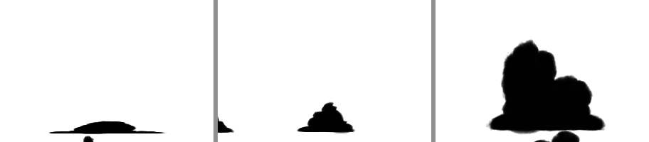
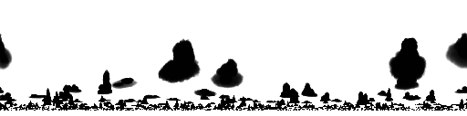

# Atmosphere, Sky, and Clouds

Alpha Piscium separates low-frequency LUTs, view-dependent sky-view/epipolar data, volumetric clouds, and final local
composition. Atmosphere preparation runs in `begin` and clouds render early in composite. Air/water resolve after
GI history fix, alongside spatial blur passes when enabled, and finish before translucency.

## Code map

| Path | Responsibility |
| --- | --- |
| [`shaders/techniques/atmospherics/air/lut/`](../../shaders/techniques/atmospherics/air/lut/) | Atmosphere LUT generation and API |
| [`atmospherics/air/Raymarching*.glsl`](../../shaders/techniques/atmospherics/air/) | Air-medium ray marching |
| [`SliceEndPoints.comp.glsl`](../../shaders/techniques/atmospherics/air/SliceEndPoints.comp.glsl) | Epipolar slice endpoints |
| [`EpipolarScattering.comp.glsl`](../../shaders/techniques/atmospherics/air/EpipolarScattering.comp.glsl) | Air epipolar-scattering kernel |
| [`Cumulus.glsl`](../../shaders/techniques/atmospherics/clouds/Cumulus.glsl), [`Cirrus.glsl`](../../shaders/techniques/atmospherics/clouds/Cirrus.glsl), [`Mediums.glsl`](../../shaders/techniques/atmospherics/clouds/Mediums.glsl) | Cloud density, media, and phase functions |
| [`RenderVolumetric.comp.glsl`](../../shaders/techniques/atmospherics/clouds/RenderVolumetric.comp.glsl) | Main low-cloud render |
| [`Accum.comp.glsl`](../../shaders/techniques/atmospherics/clouds/ss/Accum.comp.glsl) | Temporal/spatial cloud accumulation and upscale |
| [`atmospherics/clouds/amblut/`](../../shaders/techniques/atmospherics/clouds/amblut/) | Cloud ambient-light LUT sampling and gathering |
| [`SkyComposite.glsl`](../../shaders/techniques/atmospherics/SkyComposite.glsl), [`LocalComposite.glsl`](../../shaders/techniques/atmospherics/LocalComposite.glsl) | Shared sky and local-volume composition |
| [`shaders/util/Celestial.glsl`](../../shaders/util/Celestial.glsl) | Project sun, moon, star-map, and constellation logic |

## Begin: LUT and frame preparation

The LUT update sequence follows these dependencies.

| Order | Pass | Purpose |
| --- | --- | --- |
| 1 | [`GenerateTransmittance`](../../shaders/techniques/atmospherics/air/lut/GenerateTransmittance.comp.glsl) | Updates the 256×64 `persistent_transmittanceLUT` |
| 2 | [`SliceEndPoints`](../../shaders/techniques/atmospherics/air/SliceEndPoints.comp.glsl) | Updates epipolar geometry for the frame |
| 3 | [`GenerateMultiSctr`](../../shaders/techniques/atmospherics/air/lut/GenerateMultiSctr.comp.glsl) | Updates the 32×32 `persistent_multiSctrLUT` |
| 4 | [`clouds/amblut/Sample`](../../shaders/techniques/atmospherics/clouds/amblut/Sample.comp.glsl) | Samples previous/current cloud ambient information |
| 5 | [`GenerateSkyViewLUT`](../../shaders/techniques/atmospherics/air/lut/GenerateSkyViewLUT.comp.glsl) | Writes `uimg_skyViewLUT` |
| 6 | [`clouds/amblut/Gather`](../../shaders/techniques/atmospherics/clouds/amblut/Gather.comp.glsl) | Writes the 32×192 `persistent_cloudsAmbLUT` |

Fixed LUT dimensions are declared in [`shaders/shadesmith.json`](../../shaders/shadesmith.json);
screen-sized/configurable images are declared in [`scripts/shaders.properties`](../../scripts/shaders.properties).

Both `uimg_skyViewLUT` dimensions use `SETTING_SKYVIEW_RES`. The fixed `persistent_epipolarData` tile is 2048×3073.
`SETTING_EPIPOLAR_SLICES` selects the active width, and `SETTING_SLICE_SAMPLES` selects a logical height of
385, 769, 1537, or 3073 for three layers plus the endpoints row. When adding a sample count,
check the tile capacity, dispatch, and indexing in [the epipolar code](../../shaders/techniques/atmospherics/air/).

## Cloud passes

The [first procedural cloud-modeling revision](#首版建模交付) defines the geometry and its integration into the current renderer.

When `SETTING_CLOUDS_CU` is enabled:

| Order | Pass | Purpose |
| --- | --- | --- |
| 1 | [`RenderVolumetric`](../../shaders/techniques/atmospherics/clouds/RenderVolumetric.comp.glsl) | Ray marches cumulus using the ambient LUT, atmosphere LUTs, shadows/lights, and project cloud noise |
| 2 | [`clouds/ss/Accum`](../../shaders/techniques/atmospherics/clouds/ss/Accum.comp.glsl) | Applies history accumulation, confidence/variance processing, and upscaling to the low-resolution result; this is the [`ss/Accum`](../../shaders/techniques/atmospherics/clouds/ss/Accum.comp.glsl) stage |
| 3 | Later air/local composition | Reads the accumulated cloud scattering and transmittance |

The directional sky LUT has three scattering/transmittance pairs. The first stores the complete sky from the camera. The other two store air below and above cirrus. A displaced environment ray checks parallax against the LUT's half-texel footprint and marches from the surface if the displacement is resolved. Opaque geometry clips the main ray. Water and glass split it into background and foreground segments. History stores extinction-weighted distance in kilometres for reprojection. [World-space cloud integration](../../shaders/techniques/atmospherics/clouds/CumulusRay.glsl) · [Environment rays](../../shaders/techniques/atmospherics/clouds/SkyRay.glsl)

The main screen tiles are `transient_lowCloudRender`, `transient_lowCloudAccumulated`, and `history_lowCloud` (
RGBA32UI). The hand-maintained property fragment declares custom cloud phase-LUT, cirrus, cumulus base/detail, and curl
textures. High cirrus is sampled by the shared sky/cloud path rather than a separate compute program.

### Cumulus isotropic multiple scattering

The cumulus renderer reuses the existing ordered eight-sample sun-light column. For each source sample jittered uniformly in distance within its quadratic-distance bin,
let `U_i` be the prefix optical depth from the start of the light column to that source position, `sigma_s` the scattering coefficient,
`sigma_tr` the transport coefficient, `ds` the sample length, and `r` the source radius. This diffusion approximation
uses `sigma_tr ≈ sigma_t` in the implementation. With dimensionless absorption fraction (albedo deficit) `a = 0.001`
multiplying optical depth, per-channel asymmetry `g`, and `k = sqrt(3a)`, the direct upstream-prefix estimator is

$$
W_i=\frac{(\sigma_s\,ds)\sigma_{tr}}{r},\qquad
\Phi=\sum_{i=1}^{8}W_i e^{-aU_i}
     \left(1-e^{-(1-g)U_i}\right)e^{-kU_i}.
$$

The implementation clamps the build rate `1 - g` to a nonnegative value so transformed color spaces cannot turn
scattering buildup into amplification.

Intensity is applied before a fixed soft compression:

$$
\Phi_{\mathrm{mapped}}=1-e^{-\max(\mathrm{intensity}\,\Phi,0)}.
$$

This bounds each mapped channel below `1`. `SETTING_CLOUDS_CU_ISOTROPIC_MS_INTENSITY` supplies `intensity`; `0`
disables the contribution, the default `1.0` is the current artistic gain, and `0.25` approximately matches the
omitted `3/(4π)` normalization reference. The result is added independently of the existing WDT22
multiple-scattering term; it does not replace or modify that term.

The accumulated `phi_fwd` field is isotropic and follows the prefix estimator, but final view-path readout intentionally
uses `msPhase = mix(UNIFORM_PHASE, medium.phase, 0.7)` to retain controlled directional structure. This
rendering choice is layered after the isotropic field, not part of its transport recurrence.

The receiver-local boundary multiplier uses the upward normal of the dominant cluster and the selected sun or moon direction. The top factor is `mix(1, saturate((dot(N, L) + 0.5) / 1.5), 0.25)`. The bottom factor is `1 - exp(-h / (0.1 * mix(1, 4, development)))`, where receiver height is normalized to its own cluster and development is measured against the configured thickness. Their product gates the eight diffusion samples. The direct-light column continues through the shared field beyond those bins until it exits the volume or reaches green-channel optical depth 5.3.

The estimator is adapted from AshenOneArt's [HanPi Volume Cloud implementation](https://github.com/AshenOneArt/HPVolumeCloud/blob/27e799914493de9fa527179312ed72a39d08e225/VolumetricClouds.hlsl)
and [forward-flux derivation](https://github.com/AshenOneArt/HPVolumeCloud/blob/27e799914493de9fa527179312ed72a39d08e225/Docs/PhiFwd_FromRTE.md).

## Air, depth layers, and composition

| Stage | Pass/code | Purpose |
| --- | --- | --- |
| GI phase | [`GIDenoiserEdgeClassificationAndVolumetricsDepthLayers`](../../shaders/pass/composite/GIDenoiserEdgeClassificationAndVolumetricsDepthLayers.comp.glsl) | Builds the depth layers required by volumetrics |
| Air volume | [`EpipolarScatteringAir`](../../shaders/pass/composite/EpipolarScatteringAir.comp.glsl) | Consumes endpoints, epipolar data, LUTs, shadows, and depth layers to produce air scattering |
| Water/translucency | Shared code such as [`LocalComposite.glsl`](../../shaders/techniques/atmospherics/LocalComposite.glsl) | Merges sky, clouds, and local media for water scattering and translucent back composite/SST/composite |
| Optional correction | [`VolumetricLocalCompositeBreakFix`](../../shaders/pass/composite/VolumetricLocalCompositeBreakFix.comp.glsl) | Corrects depth breaks at the end |

## Sky and celestial rendering

Vanilla clouds, sun, moon, sky, and stars are disabled in the project property fragment. Alpha Piscium renders them
through its own sky composite and [`Celestial.glsl`](../../shaders/util/Celestial.glsl), conditionally binding
`usam_starmap` only when star intensity is nonzero and `usam_constellations` only when its setting is enabled.

## Settings

| Category | Settings |
| --- | --- |
| Atmosphere scale/ground | Altitude, density scale, and ground albedo |
| Air | Epipolar slices/samples; Mie turbidity/time curve; Mie/Rayleigh/ozone multipliers |
| Sky/light shafts | Sky-view resolution, sky samples, shaft samples/shadow samples, depth-break correction, and softness |
| Low cloud | Upscale factor; history length/confidence/variance; minimum/maximum steps; height/thickness/density/coverage/phase; isotropic multiple-scattering intensity; wind; and shape frequencies |
| High cloud | Cirrus height, density, coverage, and phase |
| Celestial | Sun/moon radius, distance, temperature/color/albedo; star-map intensity/gamma/bright-star boost; and constellations |

All settings are declared in [`scripts/options.main.kts`](../../scripts/options.main.kts); profiles mainly scale
epipolar resolution, cloud upscale, history length, and march steps.

## Maintenance invariants

- Change LUT coordinate conventions and every API consumer together.
- Keep epipolar counts within the declared size mapping.
- Keep cloud-history render resolution, upscale factor, jitter, and confidence logic aligned.
- Change binary assets, `customTexture.*` declarations, and samplers together.
- Test the full day cycle, weather, water transitions, fast turns, both sides of cloud layers, and history resets.

## 程序化云的水平分布、垂直结构与保守边界

实拍编号对应主检出本地的 `agent_inputs/cloud-references/index.html`。地面全景适合判断云区交界和遮挡次序，侧视适合判断同一云体的底宽与塔冠，斜俯视适合判断连通性和云隙。绝对高度和间距按世界尺度试摆。

### 首版建模交付

本次授权在正常 Iris 云渲染路径中实现程序化云形。优先让淡、中、浓积云出现在同一片可飞入的天空，保留现有高云的天空合成。世界 XZ 的云区决定成团方向、蓝隙和凝结底高，同一 XZ 可以有多段云和层间净空。形状按 1 方块 = 1 米求值。相机、太阳透射和屏幕外采样在同一位置和游戏时刻应读到同一云场。继续使用现有光照完成形状接入。新的云光照模型另行讨论，游戏晴雨驱动与云团生成消散留待后续。

每一层细节经过形变、侵蚀与过滤后仍须包含在当前父包络内。整团随风运动，局部可升腾、偏移。重载光影或重进存档时，相同世界位置、游戏时刻与设置应得到相同云形。底宽、塔高、瓣数、噪声与 LOD 细节交给实现者按实拍试调。用户选中的动画构图是 `anime-sky-01` 和 `anime-sky-03`，实拍是 `SKY-031`、`SKY-032`、`SKY-106` 和 `Cu-ref-02/03/05/07/09/10`。整幅图可用于观察主次、蓝隙、宽底和偏塔，具体云团的位置、高矮和数目允许变化。跨检出查看时从主检出的 `agent_inputs/cloud-references/` 打开图库。

交付以可运行的 shader 和同场景对照为准。用开阔地环视、绕塔飞近、穿云及云上俯视检查三种积云的轮廓与遮挡。用透射图核对塔间和层间的空隙，在动画与远近 LOD 交替处核对保守边界。在固定游戏时刻重载，比较云形。按相同场景、分辨率和设置对照改动前后的整帧 GPU 时间，首版上限为原来的 1.30 倍，同时记录云相关 pass 以便定位开销。实现、实机对照和可恢复的修正可连续推进，遇到影响美术目标、支持范围或帧时间上限的取舍时交回设计讨论。

### XZ 分布与垂直叠置

| 照片 | 可见特征 | 对生成器的约束 |
| --- | --- | --- |
| SKY-098、SKY-122 | 航拍中小塔断续成列，列内仍有缺口；另一些区域云块汇合，开口可以看见地面 | 分开控制云团中心的疏密、沿某方向的聚集倾向、单团足迹大小。三者共同决定覆盖率。 |
| SKY-033、SKY-200 | 全景里厚团、宽蓝隙和细碎云片相邻；另一张中数条云带近平行，其中一条由许多小块串成 | 给云斑、云带有限的水平范围和逐渐散开的边缘。允许带内断裂、同一片天空局部换形态。 |
| SKY-106、SKY-127 | 窗外的孤立塔高出较低云面；另一次航拍中，飞机上方是灰底，下方是能透见地面的云块 | 同一 XZ 可以有多个不连通的有云区间，层间净空必须可查询。塔基有时被前景挡住，不能据照片把它焊到前景云面。 |
| SKY-164、Cu-ref-02、Cu-ref-03 | 近处暗云挡住远方亮塔；另一组照片中几个塔头共用宽底、彼此高低错落 | 分别生成视线叠置和同体分枝。只凭亮度或图上的上下次序无法推断前后两块属于同一云体。 |

首版可在世界 XZ 上按种子重建有范围的云区。对流区由局部凝结底高、可发展厚度、聚集强度和带向控制。先用低频分布确定哪里聚团、哪里留空，再在区域内对带扰动的候选中心进行确定性筛选；沿带与横带使用不同相关长度即可得到断续云列。每个中心有独立的底宽与发展程度，邻近中心共享缓变的底高。高覆盖可以来自许多浅云，也可以来自少数连片的宽底。云塔可以孤立出现，也可局部聚成一列。厚度上限限制对流发展，实际塔顶由每簇上升枝决定。云区可叠置，不把一个地面坐标锁给一个云种。

默认水平和垂直尺度均为 1 方块 = 1 米。开阔平地转一圈，中远处至少要有一处能认出浓积云的轮廓，典型构图可读出一至三处，对流旺盛的方向也可以更多。一座孤塔、同一宽底上的几座塔头或远近搭接的两团都可以构成一处视觉重心。各处的大小和间隔应有差别，单独一个朝向可以留出很大一片蓝天。世界 XZ 上对流区的间距、范围与局部发展强度决定这幅构图。玩家的位置和朝向只用于观察。

本地图库 `agent_inputs/cloud-references/composition/index.html` 将四张动画截图中的六个局部与实拍并列。实拍 SKY-033 可看左侧厚团和右侧云片之间成片的蓝天，SKY-164 可看近处暗云的开口怎样框住远处宽塔和一串矮云头，SKY-183 可看几座细高云塔在开口中各自显出轮廓。首幅构图试取一组距海平面观察者水平 5 千米、底高 1 千米、顶高 3 千米的云塔，正侧面仰角约从 11° 到 31°。这些尺寸用于试摆，其他云区仍有各自的底高和可发展厚度。[当前高度与距离设置](../../scripts/options.main.kts)

层云、高层云和雨层云可先用有缺口的宽片体表达，以局部起伏的上下表面包住有厚度的云幕。层积云、高积云和卷积云用有限片区内的云卷或胞状团块，分别调节连通性、单元尺度、排列和层厚；细粒的视大小同时受距离影响。卷层云可用薄幕，卷云可用沿曲线展开、逐渐变细的纤维束。积雨云另需表达高处横展的砧部。对流塔遇稳定层而横向展开时，可将展开部分接在同一塔群上；独立过境的云幕则保留自己的底高、厚度与水平运动。[WMO 积云发展与稳定层](https://cloudatlas.wmo.int/en/explanatory-remarks-and-special-clouds-cumulus.html)

### 三种积云共用的几何

图中三列以相同底宽比较塔高、分枝和侧向偏移。每列上下两图来自同一组三维体，黄线给出这一姿态的粗轮廓。子瓣可以在里面鼓起或侧倾，贴近包络边缘时密度逐渐降到零。实际云场中底宽独立变化，底部由若干横向搭接、边缘渐薄的云团构成，只在局部接近同一凝结高度。图中水平截面和简单塔冠用于比较几何，云底的密度过渡、花椰菜的小瓣和光照另行计算。

| 形态 | 粗级轮廓 | 中级细化 |
| --- | --- | --- |
| 淡积云 | 浅厚度预算，云肩横向展开，个体之间可留下大片净空 | 少量宽而低的云瓣，侵蚀集中在薄边，保住连续可读的浅云底。 |
| 中积云 | 某个上升枝形成可辨的主丘，较矮的云肩继续撑住原有底宽 | 把圆顶分成相互搭接的瓣，在主丘与侧肩之间留下凹口。 |
| 浓积云 | 由同一宽底长出偏心主塔、侧塔和矮枝。高处允许侧移及局部悬出根部 | 大云头朝顶侧分出一簇小瓣，保留上下级之间的颈部与背光凹槽。远处应先读出主侧塔的阶梯。 |

种子固定各上升枝的位置、倾向和发育次序，发展程度连续改变各枝的高度、半径及冠部可见程度。底宽、主枝优势和可达高度分别控制。允许孤立浓积云，也允许同一个云场内多数云矮、少数云拔高。历史浓积云尝试中的宽底和主侧塔构造值得复用，旧归一化密度值需要另配世界长度单位的距离下界。

浓积云的形状对照沿用早期选中的 A 图宽底、B 图受光塔冠上的成簇小瓣，两图见本地图库的 `previews/model-pair.jpg`。Cu-ref-09 的塔尖轮廓清楚，同一团右上缘却已碎散。可把次级凸瓣集中在上升枝冠部，允许部分云肩逐渐碎散，保留一段宽而完整的底。云芯有多厚可用穿过塔身的透射图检查，另取一条穿过两塔开口的视线核对是否确实留空。

美术上先按实拍建立形体，把动画参考中的主次和留白带入布局。亮边、背光凹槽与日落色交给同一密度场在不同照明下呈现。主塔应夸张到什么程度留给原型比较。可固定世界位置、镜头、光照、曝光和底宽，只改变主塔相对侧塔的高度，对照全景中的辨识度和飞近后的轮廓。

### 保守步进与密度

首版由当前帧的父 SDF 直接裁边。以世界空间同一采样点为准，$P$ 是父包络，$C$ 是子瓣当前姿态的几何场，均取内负外正。几何层级逐级取交，沿每条父子路径只在最终密度上做一次边缘淡出。$\epsilon>0$ 是很小的数值余量，$w>0$ 是内侧过渡宽度。

$$
d=\max(P+\epsilon,C),\qquad
\rho=\rho_{\rm shape}\,\operatorname{clamp}(-d/w,0,1).
$$

$\rho_{\rm shape}$ 取局部形变、噪声侵蚀和密度过滤后的值。父场始终在原采样点求值。父包络外可以在读取细节前跳空，内侧窄带才压低密度。即使塔冠摆得太远，裁过的子瓣连同边界也落在 $P\le-\epsilon$ 内。每个子瓣先受自己的父瓣约束，再合并同级结果。若云边显出过于规整的轮廓，可复用塑形时已采到的非负噪声，让淡出起点局部向内退。现有积云可复用 [detailNoiseB 的采样结果](../../shaders/techniques/atmospherics/clouds/Cumulus.glsl)。

整片云的形状和细节共用一个由游戏时间确定的 XZ 风偏移，云瓣布局由区域格号和稳定种子重建。现有细节风取 `frameTimeCounter`，新云形应从 `worldDay` 和 `worldTime` 求风位移与形变相位，跨午夜连续，同一游戏时刻重载可重建。相机、太阳和屏幕外查询使用同一时刻的几何。空间格按本帧父包络纳入跨格云瓣。只掌握本格候选时，跳空最多走到本格出口。[现有风输入](../../scripts/shaders.properties) · [游戏时间输入](../../shaders/base/Uniforms.glsl)

积云塔群、片状云和纤维状卷云可以各用合适的形状表达。每类形状都给出射线上可能有云的范围或安全跳空距离，并能在给定世界位置求标量密度。相机、太阳透射和屏幕外查询可按各自的采样精度读取同一云场，远级仍须保住可辨的塔形和贯通云隙。当前低云视线与天空合成都使用固定积云层高。新场接入时应沿射线按实际深度处理近云、层间净空和远塔，在候选区间重叠处按局部介质积分一次。可用相机位于两层之间、分别向上和向下看作为接入对照。[低云视线](../../shaders/techniques/atmospherics/clouds/RenderVolumetric.comp.glsl) · [天空合成](../../shaders/techniques/atmospherics/SkyComposite.glsl)

步长取有距离下界的几何场。椭球可用 $r_{\min}(\|(p-c)/r\|_2-1)$，这类 1-Lipschitz 场的 $\min$、$\max$ 与反号仍保留该界，塔头之间用几何挖出的凹口也可跳过。薄片先裁射线的上下区间。两个 LOD 做密度混合时，各自先裁边，用包住两者的粗级跳空。[Hart，Sphere tracing](https://graphics.stanford.edu/courses/cs348b-20-spring-content/uploads/hart.pdf)

首版形状原型有两个可单独核对的细节。

- 同一云团内，底座、主塔和子瓣共同描述一份密度。可先对各瓣裁边后的标量密度取最大值。原样复制一个云瓣后，同一视线的透射应相同。若直接累加，原本 50% 的透射会在完全重复时降到 25%。
- 同底宽的三种积云里，淡积云较薄，固定米数的淡出容易吃掉宽底。对单个椭球，可先让 $w$ 取其最短半轴的一小部分，使过渡占各轴相近的比例。用淡积云核对云底是否仍连贯，再看浓积云冠部的小瓣是否仍分明。

第一轮几何对照可固定体场，从几个开阔地面位置环视，检查远塔是否可辨、主次和蓝隙是否自然。挑一座塔飞近并绕到侧面，看宽底、侧塔和层间空隙的关系怎样随视角变化。再以俯视覆盖、侧面轮廓和透射图检查云列间隙、分级塔冠和层间净空。穿过 SKY-116 一类的近云缘，在同一体场换太阳方向，看背光凹槽是否来自真实密度。远级密度近似需要另查列光学厚度，直接填满粗包络会抹掉细级云隙。首版整帧预算仍为同场景现状的 1.30 倍。示意图只检查了几何包含关系，实际求值次数、掠射步数及整帧耗时待 Iris 对照。

## 程序化积云实验记录

以下体积切片和镜位属于第一轮实验。用户实机退回了 `478b66d2` 的云形，该修订还发生过 GPU 超时。后续修订及验收范围见[实拍与实机复核](#实拍与实机复核)。

2026-11-21，实验分支 `codex/procedural-cloud-shapes`，规格与对照基线 `85321456`，shader 候选 `478b66d2`。
两套相互错开的 XZ 格生成独立云团，低频风带控制聚集方向和疏密。主塔、侧肩、次枝和冠瓣分别在父包络内裁边。
格面限制跳空距离，体积重叠处取最大局部密度。照明复用既有介质、相函数、WDT22 和八采样点的局部各向同性多重散射。

### 世界尺度与透射

CPU SwiftShader 使用候选 GLSL 和包内四张噪声纹理。游戏日 7、第 6000 tick，默认风与云设置。
20 × 20 km 体积内的 XZ 样本间隔为 156.25 m，垂直间隔为 26.79 m。下表为密度大于 0.04 的三个连通体。
侧视图依次为淡、中、浓积云，每栏宽 3.9 km、高 2.6 km，白色为全透射，黑色接近不透光。

| 形态 | 样本厚度 | 水平包围盒 X × Z |
| --- | ---: | ---: |
| 淡积云 | 241 m | 2.19 × 2.97 km |
| 中积云 | 536 m | 1.09 × 1.25 km |
| 浓积云 | 1,714 m | 2.19 × 2.19 km |

下图为世界眼点 `(52200, 102, 34800)` 的绿色通道透射。水平一圈，仰角从 −2° 到 55°，方位角从 +Z 向 +X 增长。
仰角 22.27°、方位 138.87°、158.55°、174.73° 的透射分别为 0.00317、1.00000、0.00287，远级为 0.00312、1.00000、0.00288。
512 × 128 条视线中，83.52% 的透射超过 0.99。

- 同一 XZ 上，粗网格找到 38 列有两段密度且间隔超过 140 m。在随风坐标 `(-2.578125, 2.265625) km`，
  每 0.732 m 取样的细级零密度间隙为海平面上 1087.01–1302.34 m，远级为 1087.74–1301.61 m。细级上下两段的透射为 0.00457 和 0.00000578。
- 两次独立创建 CPU 管线，在相同时刻输出的全景缓冲逐字节相同。午夜前后各 40,960 个随机位置中，
  父界外正密度、每个正跳距内部七个测试点的正密度、复制同团后的密度变化均为零。
  另对两个时刻各 73,728 个位置使用视线、光线和反向查询，同位置同 LOD 的最大密度差为零。
- 细远 LOD 全景的绝对透射差均值为 0.00036，P99 为 0.01083，最大为 0.08388。
  5,120 条配对视线对照 12 m 等距积分，绝对差均值为 0.00057，P99 为 0.01239，最大为 0.08838。边缘缩短步长前，同组掠射线的最大误差约 0.94。
- CPU 驱动缺少着色器 FP64。用 GLM 编译世界原点函数的算术，风开关各 75 组，覆盖世界边界、跨午夜及从不同相机原点查询同一点。
  启风时与双精度参考的最大位置差为 0.116 m，同一时刻重新求值逐位相同。
  12 个入口在默认、关风、关卷云、关积云四组设置下通过 GLSL 静态编译。

### Iris 验收镜位与量测

实机基准用 `cloud-6-720p`，晴天、1280 × 720、第 6000 tick、默认设置。
核对加载的 shader、世界时刻、相机、配置与暖机，按基线／候选／候选／基线配对采样。
记录整帧 GPU 时间、天空视图 LUT、积云积分与累积、受影响的 GI 和透明合成 pass，以及固定工作量的透射 LUT `begin1_b`。整帧上限为基线的 1.30 倍。

现有六个云预设都在低处，Vibris 单次相机移动每轴最多 16 方块。绕塔与穿层使用独立的实际世界镜位。
第 0 天、第 6000 tick 时，`X = −778.125, Z = 3465.625` 的下层占世界 Y 约 822–1138，上层占 Y 约 1358–2148。
可在 Y 约 1250 分别仰视和俯视，在 Y 约 1358 以短路径穿过云底，再从 Y 约 3300 俯瞰塔及地面。记录实际游戏眼点。
该运行的 `iris-scenes.json` 备有 16 个候选镜位，涵盖八个绕塔方位、三个进近距离及五个穿层或俯视位置。
目标 Iris 编译、固定时刻重载、环视、绕塔、穿云、俯视与整帧／pass 配对时间等待 GPU 租约。

<!-- vela:evidence {"run":"d93e4589-1ab6-4287-9fa3-181ffd46cb98","path":"field-sections.png"} -->
<!-- vela:evidence {"run":"d93e4589-1ab6-4287-9fa3-181ffd46cb98","path":"sky-transmittance.png"} -->
<!-- vela:evidence {"run":"d93e4589-1ab6-4287-9fa3-181ffd46cb98","path":"geometry.json"} -->
<!-- vela:evidence {"run":"d93e4589-1ab6-4287-9fa3-181ffd46cb98","path":"cpu-reproduction.zip"} -->

## 实拍与实机复核

云形以真实照片为准。淡积云参照 Cu-hum-01、Cu-hum-03 的凝结底、厚芯和渐散的浅肩，浓积云参照 Cu-ref-03、Cu-ref-09 的宽肩、塔腰和分瓣塔冠。动画图用于全景疏密。用户圈出的四幅图保存在主检出 `agent_inputs/cloud-references/experiments/2026-11-cumulus/`。其中两幅可在下述 Iris `ground-180` 和 `ground-0` 镜位认出相同云团。

### 实机退出与有上限的采样

2026-11-21，手动实例在 RTX 3080 Ti 上加载了 `Alpha-Piscium-3`。太平洋时间 19:36 和 19:42 两次退出均有 NVIDIA 事件 153、Windows `LiveKernelEvent 141` 和 Java 在 `nvoglv64.dll` 中退出的记录。日志可定位 GPU 超时，具体触发指令或 pass 仍未知。[Microsoft 的 0x141 说明](https://learn.microsoft.com/windows-hardware/drivers/debugger/bug-check-0x141---video-engine-timeout-detected)

旧版把最大步数用于计算单步长度，每个非空视线段再积分整条光柱。修订 `ad10830f` 对视线区间、空格穿越和远程日照分别设上限，每条视线按绿色通道消光权重选择一次散射源。保留 WDT22、HanPi、真实世界起点和近处八个日照采样。CPU 回放的 13,824 条云内视线中，旧版单条最多访问云场 8,342 次、求值 52 条日照柱，修订版实测最多 512 次和一条。这里计入了空界查询。地面组平均云场查询从 55.2 增到 94.4 次，两组均使用各版本实际的云形。

手动存档在第 0 天、第 6000 tick，脚位约 `(−3.24, −34.57, 28.95)`，使用 Ultra、关闭 Bloom、CAS 锐化为零。固定 60° 垂直视场、16:9 和 1.62 m 眼高，在最后保存的朝向重算，绿色云透射低于 0.65 的面积从旧版的 11.9% 增至 `ad10830f` 的 19.8%。两版均以一方块一米计算。该面积描述此视角的可见云量。

### ad10830f 的 Iris 结果

专用 Minecraft 1.21.11、Iris 1.10.6-vibris.3、RTX 3080 Ti、NVIDIA 617.42。640 × 360 先行编译后，720p 在手动实例的两项设置下完成 15 个镜位，包括四向环视、四向绕塔、层间上下视线、穿层和俯视。固定时刻重载两次，暖机各 96 帧。天空区域抽取 9,440 个 RGB 像素，浅色云掩模交并比 0.9943，归一化 RGB 绝对差均值 0.00228。穿层作业允许世界时间推进，运动和两张截图之间连续等待 7,168 帧，等待约 65 秒。该轮全部实机操作的系统日志窗口未见新的 NVIDIA 事件 153。

下表比较规格基线 `85321456` 与 `ad10830f`，使用同一 `cloud-6-720p`、默认 Ultra、1280 × 720 和同一场景收据。349 个共有设置的有效值全部一致。旧版独有三个已经移除的曲线设置，候选独有六个 Iris 识别到的包含／预处理标记。各 pass 用两轮 ABBA，每次暖机 48 帧、测量 96 帧。整帧另作一轮 ABBA，每次暖机 64 帧、测量 160 帧，从 PresentMon 的游戏 PID 样本各取窗口中央 96 帧，以每次 P50 作配对。两对整帧比值为 1.137 和 1.096。

| 指标（ms） | 规格基线 | ad10830f |
| --- | ---: | ---: |
| 整帧 GPU 时间 | 10.440 | 11.658 |
| 整帧 GPU 忙碌时间 | 6.531 | 7.407 |
| 天空视图 LUT · begin3_a | 0.140 | 0.500 |
| 视线积云 · composite9 | 0.940 | 1.151 |
| 积云累积 · composite10 | 0.130 | 0.151 |
| 透明反射／折射 · composite42 | 0.014 | 0.020 |
| 透明合成 · composite43 | 0.047 | 0.074 |
| 对照透射 LUT · begin1_b | 0.010 | 0.010 |

该场景的整帧比值为 **1.117**，低于 1.30。已排除有重复且互相冲突的聚合计时项。完整 pass、计时窗口和运行收据保存在 `iris-evidence.zip`。此结果和稳定性观测仅覆盖 `ad10830f`。

### 033741cc 的圈图修正

在相同世界位置和时刻追踪每个采样所属的父团。图 2 的近塔单独转过 90° 和 180° 后，仍能看见原来的等宽斜身。图 1 所在方向的一块浅云区域，在 1,200 条可见云视线中有 402 条同时收到两个父团各超过 0.05 的不透明度贡献。邻近亮边既有同团轮廓，也有前后叠置。

`033741cc` 维持云团布局，分别塑出塔根、侧肩、收窄的塔腰和不等大的冠瓣。浅云的背风边缘按云芯距离和已有卷曲、涡胞纹理侵蚀，粗密度和细密度共用局部含水量。每支上升体以未扭曲坐标上的父包络裁边。浅云两级小冠使用不同朝向和半径，边缘可逐段断开。

同一朵淡积云的 15° 仰视、12 m 参考积分和投影窗口均固定。下列数值描述一次配对，照片没有标定透射率。T 为绿色通道透射。

| 同镜位测量 | ad10830f | 033741cc |
| --- | ---: | ---: |
| 可见云体像素（T < 0.95） | 24,218 | 19,802 |
| 近乎不透明（T < 0.05） | 13,667 | 7,994 |
| 半透像素（0.35 < T < 0.95） | 5,527 | 6,392 |
| 旧轮廓内 1–5 像素的同一批视线，T 中位数 | 0.803 | 1.000 |
| 旧轮廓内至少 25 像素的同一批视线，T 中位数 | 0.00287 | 0.01715 |

修订后可见云体中近乎不透明的比例从 56.4% 降到 40.4%，较深的 9,999 条视线中仍无一条全清。手动存档最后朝向的透视画面中，T < 0.65 的画面占比为 18.1%。真实照片、同团转向和透射对照在本轮 `layout-comparison.png`。主检出图库的 `agent_inputs/cloud-references/experiments/2026-11-cumulus/05-photo-shape-comparison.png` 是同一张图，与用户的四幅圈图放在一起。

最新云形通过 12 个实际入口、四组设置共 48 次静态编译。CPU 在午夜两侧共 81,920 个点复核父界、空跳和重复云瓣，在 147,456 个点比较相机、光线和反向的云密度；均未发现不一致。固定时刻的重复全景逐字节一致，细远 LOD 的绝对透射差均值 0.00034、P99 0.00809。相对 12 m 参考积分，5,120 条视线的绝对差均值 0.00088、P99 0.0181，最大 0.182。最新修订的对应 Iris 镜位、穿云稳定性与整帧／pass 复测等待共享 GPU。

<!-- vela:evidence {"run":"b0fec27d-8d48-4093-8199-18c6d9285e37","path":"feedback.json"} -->
<!-- vela:evidence {"run":"b0fec27d-8d48-4093-8199-18c6d9285e37","path":"forms.png"} -->
<!-- vela:evidence {"run":"b0fec27d-8d48-4093-8199-18c6d9285e37","path":"saved-views.png"} -->
<!-- vela:evidence {"run":"b0fec27d-8d48-4093-8199-18c6d9285e37","path":"reproduce.zip"} -->
<!-- vela:evidence {"run":"b0fec27d-8d48-4093-8199-18c6d9285e37","path":"iris-scenes.json"} -->
<!-- vela:evidence {"run":"b0fec27d-8d48-4093-8199-18c6d9285e37","path":"iris-views.png"} -->
<!-- vela:evidence {"run":"b0fec27d-8d48-4093-8199-18c6d9285e37","path":"iris-saved-view.png"} -->
<!-- vela:evidence {"run":"b0fec27d-8d48-4093-8199-18c6d9285e37","path":"iris-evidence.zip"} -->
<!-- vela:evidence {"run":"b0fec27d-8d48-4093-8199-18c6d9285e37","path":"layout-comparison.png"} -->
