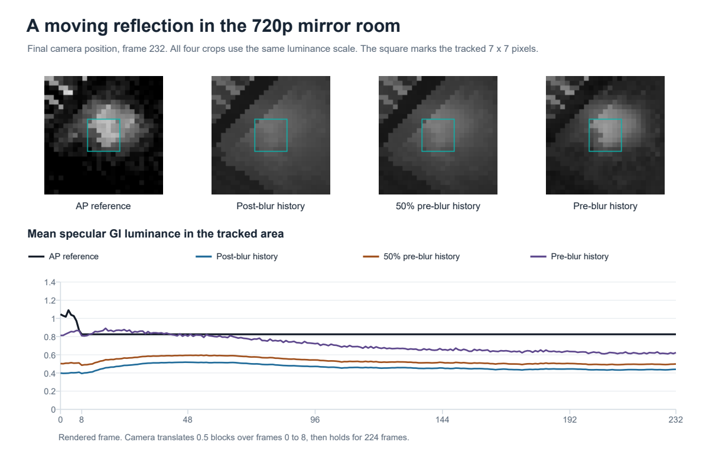

# Global Illumination

The current GI path is a screen-space ReSTIR/SST pipeline backed by an environment probe and a separate spatiotemporal
denoiser. Pass order comes from [`scripts/programs.main.kts`](../../scripts/programs.main.kts); shared algorithms
live under [`shaders/techniques/gi/`](../../shaders/techniques/gi/) and entry points are in [
`shaders/pass/composite/`](../../shaders/pass/composite/).

## Code map

| Path | Responsibility |
| --- | --- |
| [`shaders/techniques/gi/Common.glsl`](../../shaders/techniques/gi/Common.glsl) | Common GI data and accessors |
| [`InitialSample.glsl`](../../shaders/techniques/gi/InitialSample.glsl) | Initial proposals, screen-space tracing, and voxel fallback shading |
| [`Reservoir.glsl`](../../shaders/techniques/gi/Reservoir.glsl), [`PairwiseMISMetadata.glsl`](../../shaders/techniques/gi/PairwiseMISMetadata.glsl) | Reservoir encoding and pairwise-reuse metadata |
| [`ResampleMaterial.glsl`](../../shaders/techniques/gi/ResampleMaterial.glsl) | Material representation used during reuse |
| [`Reproject.glsl`](../../shaders/techniques/gi/Reproject.glsl), [`ReprojectInfo.glsl`](../../shaders/techniques/gi/ReprojectInfo.glsl) | History reprojection |
| [`Irradiance.glsl`](../../shaders/techniques/gi/Irradiance.glsl) | Shared irradiance and shading calculations |
| [`DenoiserEdgeClassification.glsl`](../../shaders/techniques/gi/DenoiserEdgeClassification.glsl), [`DenoiseBlur.glsl`](../../shaders/techniques/gi/DenoiseBlur.glsl) | Denoiser edge and blur kernels |
| [`shaders/techniques/EnvProbe.glsl`](../../shaders/techniques/EnvProbe.glsl) | Environment-probe mapping and sampling |
| [`shaders/techniques/SST2.glsl`](../../shaders/techniques/SST2.glsl), [`HiZ.glsl`](../../shaders/techniques/HiZ.glsl), [`HiZCheck.glsl`](../../shaders/techniques/HiZCheck.glsl) | Screen-space tracing and Hi-Z queries |

## Input preparation

| Order | Stage / pass | Purpose |
| --- | --- | --- |
| 1 | Geometry | Produces depth, normals, roughness, material, and light-map inputs |
| 2 | [`HiZGen`](../../shaders/pass/composite/HiZGen.csh), [`GIDenoiserEdgeClassificationAndVolumetricsDepthLayers`](../../shaders/pass/composite/GIDenoiserEdgeClassificationAndVolumetricsDepthLayers.comp.glsl), [`GIDenoiserEdgeDilation`](../../shaders/pass/composite/GIDenoiserEdgeDilation.comp.glsl), [`GIDenoiserReproject`](../../shaders/pass/composite/GIDenoiserReproject.comp.glsl) | Builds Hi-Z, classifies/dilates GI edges, and reprojects history early |
| 3 | [`DirectLighting`](../../shaders/pass/composite/DirectLighting.glsl) | Consumes the same G-buffer/shadow state before GI, so material decoding is shared |

## Environment probe

The probe preserves low-frequency/history scene information for GI queries that leave the current screen. Its update is
interleaved with GI preparation:

| Order | Pass | Purpose |
| --- | --- | --- |
| 1 | [`EnvProbeUpdate1ReprojectScatter`](../../shaders/pass/composite/EnvProbeUpdate1ReprojectScatter.comp.glsl) | Reprojects and scatters the old probe |
| 2 | [`EnvProbeUpdate2ReprojectDilate`](../../shaders/pass/composite/EnvProbeUpdate2ReprojectDilate.comp.glsl) | Fills reprojection holes twice with `PASS=1` and `PASS=2` |
| 3 | [`EnvProbeUpdate3ReprojectGather`](../../shaders/pass/composite/EnvProbeUpdate3ReprojectGather.comp.glsl) | Gathers valid reprojected data |
| 4 | [`EnvProbeUpdate4ProjectCurrent`](../../shaders/pass/composite/EnvProbeUpdate4ProjectCurrent.comp.glsl) | Projects current-frame results back into the probe |

[`shaders/shadesmith.json`](../../shaders/shadesmith.json) declares both fixed 1024×768 tiles.
`persistent_envProbe` uses RGBA32UI and `persistent_envProbeTemp` uses RGBA16F.
[`ClearEnvProbe`](../../shaders/pass/begin/ClearEnvProbe.comp.glsl) clears the probe when needed.

## ReSTIR/SST pass flow

| Order | Pass | Notes |
| --- | --- | --- |
| 1 | [`GIReSTIRInitalSampleHiZ`](../../shaders/pass/composite/GIReSTIRInitalSampleHiZ.comp.glsl) | Generates initial candidates and traces the screen-space path |
| 2 | [`GIReSTIRInitalSampleVoxelFallback`](../../shaders/pass/composite/GIReSTIRInitalSampleVoxelFallback.comp.glsl) | Traces candidates marked for voxel fallback |
| 3 | [`GIReSTIRTemporalReuse`](../../shaders/pass/composite/GIReSTIRTemporalReuse.comp.glsl) | Reprojects previous reservoirs, samples, hit normals, and material |
| 4 | [`GIReSTIRDuplicationMapDecorrelate`](../../shaders/pass/composite/GIReSTIRDuplicationMapDecorrelate.comp.glsl) | Optional decorrelation |
| 5 | [`GIReSTIRPairedSpatialReuse`](../../shaders/pass/composite/GIReSTIRPairedSpatialReuse.comp.glsl) × 1–4 | Pairwise reuse in batches of seven base samples; accumulates the specular BRDF-ratio resolve |
| 6 | [`GIReSTIRPairedSpatialShade`](../../shaders/pass/composite/GIReSTIRPairedSpatialShade.comp.glsl) | Shades selected samples, blends specular toward the ratio resolve by roughness, and queues neighbor visibility rays |
| 7 | [`GIReSTIRSpatialReuseTrace`](../../shaders/pass/composite/GIReSTIRSpatialReuseTrace.comp.glsl) | Traces the compacted visibility queue; occluded samples contribute zero except the ratio specular |

The four spatial-reuse passes use `PASS_INDEX` 0–3 and `PASS_BASE_SAMPLE_INDEX` 0/7/14/21, dispatched indirectly from
SSBO 0 offset 48. `history_restir_reservoirTemporal`, `history_restir_primary`, `history_restir_prevSample`, and
`history_restir_prevHitNormal` retain previous-frame inputs; `transient_restir_reservoirTemporal`,
`transient_restir_primary`, `transient_restir_spatialInput`, and `transient_restir_pairwiseMISMetadata` connect the
current-frame stages. [
`GIReSTIRPairedSpatialShade`](../../shaders/pass/composite/GIReSTIRPairedSpatialShade.comp.glsl) copies the current
temporal reservoir and primary data to their fixed history tiles while performing the final current-frame reads. All
tile definitions live in [`shaders/shadesmith.json`](../../shaders/shadesmith.json).

Spatial shading writes provisional diffuse/specular results immediately. Neighbor selections that need voxel
visibility store the octahedral `resultY` direction, its hit distance, and the ratio blend (ratio specular and ReSTIR
weight) in `transient_restir_pairwiseMISMetadata`; each 16×16 tile then appends its
rays to SSBO 1 as one contiguous run ordered by world-direction octant and Morton position, counted by
`global_restirVisibilityRayCount` (reset in [`UpdateGlobalData`](../../shaders/pass/begin/UpdateGlobalData.comp.glsl)).
The trace pass launches over the screen-sized queue capacity, exits past that count, and replaces only provisional
results that fail the voxel visibility test with zero diffuse and the ratio-only specular.

Specular is `mix(ratioSpec, restirSpec, roughness)`, with the linear GGX roughness of the center. The ratio resolve
runs over the center's and every same-plane paired pixel's temporal sample, across all spatial batches. Each sample
contributes its own-frame specular estimate `L·W·f_o` under the center material, capped by the sample's own target BRDF,
with weight `min(f_r / f_o, 1)`: `f_r` is the center's specular BRDF toward the sample hit and `f_o` the same BRDF in
the sample's own frame. It has no visibility or Jacobian term. The paired passes keep the weighted mean and weight sum in
`transient_ssgiSpecOut`, which is otherwise unused until spatial shading writes the final result.

## GI denoising

After ReSTIR shading, the pipeline runs:

| Order | Pass | Purpose |
| --- | --- | --- |
| 1 | [`GIDenoiserAccum`](../../shaders/pass/composite/GIDenoiserAccum.comp.glsl) | Temporal accumulation; updates `history_gi1`…`history_gi5` |
| 2 | [`GIDenoiserAntiFireFly`](../../shaders/pass/composite/GIDenoiserAntiFireFly.comp.glsl) | Optional anti-firefly pass |
| 3 | [`GIDenoiserGIMip`](../../shaders/pass/composite/GIDenoiserGIMip.comp.glsl) | Builds diffuse/specular mip inputs through indirect dispatch from SSBO 0 offset 16 |
| 4 | [`GIDenoiserHistoryFix`](../../shaders/pass/composite/GIDenoiserHistoryFix.comp.glsl) | Repairs low-confidence history |
| 5 | [`GIDenoiserBlur`](../../shaders/pass/composite/GIDenoiserBlur.comp.glsl), [`GIDenoiserPostBlur`](../../shaders/pass/composite/GIDenoiserPostBlur.comp.glsl) | Optional blur and post-blur passes |

Accum uses the fast-history alpha for luminance second moments and packs diffuse/specular M2 into `history_gi2.w`
and `history_gi3.w`. Reprojection moves each moment with its color history, including virtual-point reprojection for
specular. The first moment is the working-space luminance of accumulated fast color. `transient_gi_variance` stores
diffuse/specular variance in RG16F before anti-firefly, history fix, or blur. Invalid history resets with fast color.

HistoryFix filters variance with a 5×5 tent kernel (separable weights `[1, 2, 3, 2, 1]`, total weight 81). Screen
edges clamp to the nearest pixel and non-solid pixels contribute zero. The spatial filter only affects the current
blur guidance. M2 stays temporally accumulated. HistoryFix writes each lobe's noise factor
`1 − Y² × safeRcp(Y² + 0.05 × filteredVariance)`, with fast-history luminance `Y`, to `transient_gi_blurGuidance.zw`.
`SETTING_DEBUG_DENOISER` displays the diffuse or specular factor. Blur uses the factor to interpolate effective
filter history length toward one and relax specular hit-distance suppression. Geometry rejection continues to use
accumulated history and diffuse blur retains shadow protection.

Reprojection also depends on `history_viewZ`, historical/current view normals, geometry normals, edge masks, and
roughness. Tile lifetime and format changes belong in [
`shaders/shadesmith.json`](../../shaders/shadesmith.json), not only in samplers.

### Next-generation denoiser design

Runtime inference and history updates run in GLSL compute inside the shader pack. Offline training and backpropagation
may use PyTorch with CUDA or any other suitable framework.

With TAA disabled, GI denoising must independently suppress noise in hard-to-sample lighting and moving reflections.
With AP TAA enabled, preserve the stability and detail of the current ReSTIR and TAA output in well-sampled diffuse
GI. A glint visible for only one or two frames may be attenuated when support from nearby samples and reprojected
reflections is weak. A persistent highlight should recover from that temporary attenuation along its motion even
when fresh paths reach the light only intermittently. Check the width of fine reflections as well as their brightness.

Ordinary scenes should stay within the cost of the current GI denoising passes at matched settings. Difficult scenes
may cost more. The denoiser may flag regions for the sampler to acquire fresh observations. Count the extra sampling
work caused by those requests in the cost comparison.

One feedback design would keep normal sampling coverage everywhere and use validly reprojected evidence from the
previous frame to allocate extra samples before drawing the current frame's fresh candidates. Estimate difficulty
from observations before firefly suppression and account for repeated reuse of the same path. The sampler owns
candidate generation and weighting. Taking a second draw only after a bright first draw and averaging the two can
systematically dim rare lights. [Kirk and Arvo on adaptive sampling bias](https://authors.library.caltech.edu/records/8sntk-73q87)

#### Bias in the production ReSTIR estimate

Production ReSTIR can have a substantial systematic offset even where its output looks stable. Let `R` be the raw GI
after reuse, shading and visibility, and `D` the denoised GI from that same sample stream, including any sampling
feedback. Let `L_ref` be the independently accumulated pre-reuse AP lighting at the same scene state and transport
settings. The [static reference](#monte-carlo-reference) reads the frame's initial candidate and shares AP's tracing
and shading approximations. Use a separate sample stream for independent labels. Compare material-remodulated
linear HDR GI before TAA and take means across realizations of the same frame.

- `mean(R) - L_ref` measures the production estimator's signed offset from the chosen AP reference.
- `mean(D) - mean(R)` measures the signed change introduced by filtering, including firefly suppression.

Record temporal noise separately. Averaging independent realizations of production ReSTIR targets its own mean.
Using `L_ref` as the target would also reward compensation for upstream bias. Responsibility for correcting that
bias remains open.

#### Anti-firefly response on controlled neighborhoods

At `add444edb`, [the anti-firefly pass](../../shaders/pass/composite/GIDenoiserAntiFireFly.comp.glsl) replaces an
outlying center with the RGB of the darkest or brightest of its eight neighbors. Its blend weight is
`clamp((history_taa.a - 1) / 3, 0, 1)`. [Setup](../../shaders/pass/setup/ClearRGBA16F.glsl) clears the TAA history
tile. Its only normal writer, [FXAA](../../shaders/pass/composite/FXAA.comp.glsl), runs with TAA enabled. On a clean
TAA-off start this code therefore predicts zero weight for the anti-firefly replacement.

A CPU enumeration used grayscale inputs after GI accumulation. Each draw had value 65 with probability `p = 1/64`
and value 1 otherwise, giving a mean of 2. In one case all nine draws were independent. In the other, one neighbor
copied the center, with seven independent neighbors. The table weights all 512 and 256 possible configurations,
respectively, by their exact probabilities.

| TAA history alpha | Blend weight | Output mean, independent | Output mean, one neighbor copies center |
| ---: | ---: | ---: | ---: |
| 0 | 0 | 2.000000 | 2.000000 |
| 2.5 | 0.5 | 1.559187 | 2.000000 |
| 4 | 1 | 1.118374 | 2.000000 |

The independent result also equals `2 + 64 * weight * ((1-p)*p^8 - p*(1-p)^8)`. At full weight a lone 65 becomes
1, while two adjacent copies stay at 65. This isolates the response of one filter step to spatial correlation.

#### Static mirror-room measurements

Vibris captured the center 512 × 288 pixels of `mirror-room-1-720p` at 1280 × 720 on an RTX 3080 Ti. The camera
and world time were fixed. The brightness comparison disabled TAA, jitter, radiance cache and path guiding.
All three jobs measured material-remodulated linear HDR luminance before TAA using the same probe on `add444edb`.
The reference averaged 1,024 fresh pre-reuse draws per pixel in 16 batches, with a separate spatial offset and phase for each
64-frame block of the sampling sequence. Production recorded raw GI and the signed filter change on the same frame.

After 128 warmup frames, raw total GI fell from 0.130992 to 0.115661 across eight successive 32-frame batches.
A separate production run warmed up for 1,024 frames and captured 2,048 more. Its 16 batch means for raw total
GI ranged from 0.112668 to 0.113405. The table uses this later window. All batches had 147,456 finite pixels.

| GI signal | AP reference | Raw after ReSTIR | Denoised | Raw − reference (% of reference) | Denoised − raw (% of raw) |
| --- | ---: | ---: | ---: | ---: | ---: |
| Diffuse + specular | 0.110284 | 0.112914 | 0.137790 | +0.002631 (+2.39%) | +0.024876 (+22.03%) |
| Specular | 0.103667 | 0.104472 | 0.129789 | +0.000804 (+0.78%) | +0.025317 (+24.23%) |

With anti-firefly enabled, the TAA history alpha used by that pass was zero at every pixel in the crop.
Turning on TAA alone gave 106.5 at every pixel after the same 128-frame warmup. The replacement weight went
from zero to one. The TAA-off filter change above therefore arose elsewhere in the GI chain. A crop mean includes
light redistributed across its edges and cannot establish the response of an individual moving highlight.

Vibris jobs `574befac-36dd-4e3a-a1ea-45ab16719b80` (early production and reference),
`f4e7314c-3685-4608-973b-4964e9f5215f` (late production) and `b1359747-33b3-40ab-b078-f1f7806ed459`
(TAA control) verified shader compilation and restored the baseline. The diagnostic patch SHA-256 was
`409a4ee78ecf36e0671821dc3d4e6b895e28ee8b1580fbce6c63a1f2b7670dd5`.

<!-- vela:evidence {"run":"7bebc71b-7ba6-47fa-b34a-d561f17c7bd3","path":"static-hdr-metrics.json"} -->

#### GI anti-firefly warmup

Since `4a473d32`, anti-firefly reads the validated, reprojected GI age before the current sample is added and
before the accumulation pass borrows neighboring history lengths. Its weight rises from zero to one over three
prior GI frames and follows the GI reset factor. Spatial-only filtering uses full weight. On the same 147,456
mirror-room pixels the warmed-up weight was one with TAA on, TAA off and temporal GI accumulation off. The first
two settings produced the same mean and maximum absolute specular correction in that frame.

Two ABBA rounds compared clean revisions `a1b54c51` and `4a473d32` with normal TAA, 128 warmup and 256 timed
frames per window. The anti-firefly pass median was 44.03 µs for both. GI accumulation measured 110.59 to
110.08 µs and the GI composite measured 63.49 to 64.51 µs. The normal TAA output also completed a separate
73-frame motion check on each revision.

#### Candidate weights with fixed histories

A small model that weights current samples and reprojected history is a candidate. To test what those weights could
achieve, hold the captured candidates fixed and fit their best nonnegative, normalized blend to an independent
reference offline. Residual error can reflect biased shading in the candidates, a missing observation or a reprojection
mismatch. Where the blend can recover a highlight, compare learned and hand-written weights using the same runtime
inputs. For a sequence, feed each predictor its own previous output and check that exported weights reproduce the
offline history updates in GLSL.

Keep ReSTIR reuse active in the noisy inputs. A reference for a moving shot needs independent samples at each
frame's camera pose, jitter, world time and lighting state, including the radiance cache when it contributes.
The [existing reference](#monte-carlo-reference) accumulates at a fixed camera. Measure signed mean brightness error
over time in a region that follows the highlight, alongside firefly lifetime and highlight recovery time. Use
material-remodulated linear HDR GI for the brightness comparison. Inspect noise and trails with TAA disabled and
check the normal TAA output for loss of detail or additional trails.

#### Moving mirror pilot

The camera translated 0.5 blocks over eight frames in `mirror-room-1-720p` and held its final pose. All nine
distinct poses have a separate 192-draw pre-reuse AP specular reference. World time was frozen, with TAA, jitter,
radiance cache and guiding off for the HDR comparison. The production sequence ran ReSTIR and GI history
continuously. For each pose the probe exported current GI, surface-reprojected and virtual-point-reprojected
specular history, their validity, and the displayed GI after the same material remodulation. The diagnostic PNGs
stored the FP16 bit patterns across byte planes. The byte ramp, frame IDs, camera poses and finite values were
checked. Crop depth and roughness agreed across the capture paths within one FP16 unit in the last place.

**Candidate upper bound.** We fit nonnegative weights summing to one per pixel in linear RGB against the first
96 reference draws, then scored the blend against the other 96. Across 430,308 nonemissive, smooth-surface
pixel-frames, RGB RMSE fell from 0.331 for the displayed denoiser to 0.204. Restricting the blend to current
and virtual-point history gave 0.207, or 0.209 with surface history instead. Among 15,031 pixel-frames where
both reference halves exceeded luminance 1, 41.7% had both references brighter than `1.1 * brightest valid
candidate + 0.01`. Mixing the available candidates cannot recover the missing peak in those observations.

A 24-coefficient softmax selector used current and candidate luminances, their differences and roughness.
It trained on one side of the crop, left a 64-pixel gap, and scored the opposite side on the second set of
reference draws. RMSE for the displayed denoiser, fitted constant weights and selector was 0.431 / 0.434 / 0.375
on the left and 0.197 / 0.196 / 0.173 on the right. For a blind test, we trained on the full mirror crop and
used the same weights on two poses in `spec-contact-2-720p`, a different room in the same world. Across 17,039
eligible pixel-frames the three errors were 1.242 / 0.858 / 0.769. These comparisons held the captured histories
fixed and used the pre-reuse AP reference as a diagnostic target. The production training target remains open.
[Reproduce the weight probe](../../scripts/gi_mirror_weight_probe.py)

**Recovery along the reflection.** The first reference half selected the strongest local contrast among 27 small
bright components on smooth nonemissive surfaces. A 17 × 17 reference patch tracked its center by normalized
correlation. The measured 7 × 7 box moved from OpenGL pixel (448, 367) to (458, 375). The two reference halves
at the endpoint averaged 0.826 and 0.824. With production history the reflection stayed outside ±20% of reference
for the three-consecutive-frame recovery criterion throughout the 224-frame hold. Over the last 64 frames the AP
reference was 0.825, raw ReSTIR averaged 0.646 and denoised GI averaged 0.438. This gives an upstream offset of
−0.179 and an additional local filtering offset of −0.208.

The next experiment changed only which specular color the second blur wrote back into history. Every variant
displayed both spatial passes. The raw colors in the tracked box were bit-identical across the two endpoint
variants over the last 64 frames. The control used 1,864 mid-brightness nonemissive pixels at the final pose
where the two reference halves agreed within 0.1 luminance. Flicker is the RMS frame-to-frame luminance change.

| Color written to history | Tracked luminance, last 64 frames | Fraction of reference | Control flicker |
| --- | ---: | ---: | ---: |
| After both spatial passes (production) | 0.438 | 53.1% | 0.00857 |
| 50% before spatial filtering, 50% after | 0.498 | 60.3% | 0.01168 |
| Before spatial filtering | 0.627 | 76.0% | 0.03835 |

With production history the tracked mean was already 0.445 after temporal accumulation. The current frame's
anti-firefly step changed it by −0.00023. The two spatial passes then reduced it to 0.438 and fed that blurred
color back to the next frame. Writing the pre-blur value into history preserved more of the reflection, with
4.47 times the control flicker. Both alternative writebacks remain experimental.

**Closed-loop weight predictor.** We exported the same 24 coefficients to GLSL. On smooth nonemissive surfaces
the test shader displayed the three-candidate blend and wrote its demodulated RGB to the next frame's regular
specular history. The baseline kept the production temporal and spatial filters. On each capture's own inputs,
GPU and offline predictions agreed to RGB RMSE 0.000031 in the mirror and 0.000089 in the other room. The table
reports RGB error against the second reference half and frame-to-frame luminance change in the control region.

| Measured quantity | Mirror, production → predictor | Other room, production → predictor |
| --- | ---: | ---: |
| RGB RMSE at moving poses with a reference | 0.331 → 0.315 (9 poses) | 1.242 → 1.273 (2 poses) |
| RGB RMSE over the final 64 stationary frames | 0.216 → 0.224 | 0.784 → 1.040 |
| Control-region flicker over those frames | 0.00857 → 0.05678 (1,864 pixels) | 0.02939 → 0.07322 (1,714 pixels) |

The mirror highlight averaged 0.418 with the predictor, down from 0.438 at identical raw input in the tracked
box over those 64 frames. Neither variant met the three-frame recovery criterion. The predictor did suppress
bright outliers on dark reference pixels. The direct recurrent replacement is rejected because the real highlight
lost energy and ordinary surfaces flickered more in both rooms. These results test this selector and writeback.

The local NumPy fixture `agent_inputs/gi-denoiser/mirror-room-x0p5-pilot.npz` contains the nine candidate sets,
references, camera poses, validity masks, geometry and three closed-loop traces. Its SHA-256 is
`1de39c9ae6f45bbbb9741134bb240adb68a76811ed43491474b57cf34e83d0a8`. Fixture metadata lists the six capture
jobs. Vibris job `026d1698-6586-4863-ac20-468fa977c178` contains both writeback endpoints,
`b3a17152-d4fe-4d42-9af2-11447cb7d539` the midpoint and `57a4ba61-785b-4490-8ccb-aac8bf92c8b4` the timings.
Job `0ea5a021-c624-42a2-afa1-4e6b877e1a27` produced the two-pose test fixture `spec-contact-x0p5-test.npz`
in the same directory, SHA-256 `98d1fff3df9a9f584ea3946f2bd543aacd9733a56553f3c60fb9a3987ad24b24`. Pass
the mirror fixture and then the test fixture to the Python weight probe to reproduce all three fixed-history scores.
The recurrent GLSL runs are `e49fe4c1-4c5c-4ea4-99cd-fe737733ec67` (mirror) and
`46187710-ed20-45eb-aad8-b8ceb94aece0` (other room, with a paired control). Both retained the shader patch.

<!-- vela:evidence {"run":"9ff82b2d-4308-4e2e-b504-62b7d11a91c2","path":"motion-metrics.json"} -->

#### Selective specular history writeback experiment

Keep both existing spatial passes in the displayed GI. Test whether runtime evidence can identify where to write
some of the pre-blur specular value to history. Use the production writeback and the fixed 50% blend as controls.
Candidate rules may use surface and reflection validity, pre-suppression observations, and their agreement across
space or time. A reused reservoir path can persist for several frames. Count that as one observation wherever
its provenance is available. Record which signal the rule actually used and whether it improved on a constant blend.

Run the decision in a GLSL feedback loop in both rooms above. Report signed changes from raw ReSTIR and the
pre-reuse reference separately, tracked highlight recovery, the rate and duration of bright excursions on dark
reference pixels, and flicker in the mid-brightness controls. Use repeated baseline windows to establish normal
variation. A candidate for the shader pack should recover more persistent highlight energy while keeping ordinary
flicker and bright outliers within that variation, also with normal TAA in the final picture. Check normal-scene
pass cost at 720p before proposing integration. If the candidates contain insufficient energy, record the local
evidence for a targeted fresh sample as a follow-up to light sampling. A measured rejection completes this experiment.

## Estimator contracts

- Voxel traces distinguish three outcomes (`voxel_traceExhausted` in [
  `VoxelTrace.glsl`](../../shaders/techniques/voxel/VoxelTrace.glsl)): a hit, a grid exit that is shaded as sky (the
  grid-boundary assumption), and step exhaustion, which is a legal zero-radiance sample for initial candidates and is
  dropped by radiance cache (RC) candidates and revalidation.
- RC faces count zero-radiance samples in M and in the control-variate weight but never select them, so a face can hold
  a valid estimate without a selected sample (`rc_reservoirValid` versus `rc_reservoirHasSample` in [
  `RadianceCache.glsl`](../../shaders/techniques/gi/RadianceCache.glsl)).
- A face estimate is the cosine-weighted mean incident radiance C_n. RC lookups and RC bounces shade it as uniform
  incidence, `(albedo * dielectric * (1 - F(NoV)) + E_spec(NoV)) * C_n` (`resampleMaterial_uniformIncidenceAlbedo` in [
  `ResampleMaterial.glsl`](../../shaders/techniques/gi/ResampleMaterial.glsl)), independent of the face reservoir's
  sample direction.

## Monte Carlo reference

`SETTING_GI_USE_REFERENCE` (Debug screen) replaces the displayed GI with an FP32 running mean of the one-sample
estimate of the initial candidate, for measuring bias and variance of the sampler.

| Order | Pass | Purpose |
| --- | --- | --- |
| 1 | [`GIReferenceAccumulate`](../../shaders/pass/composite/GIReferenceAccumulate.comp.glsl) | Runs after voxel fallback and accumulates `L / q` shaded like the reuse output. `history_giReferenceDiff` and `history_giReferenceSpec` store bit-packed FP32 sums in RGBA32UI. Diffuse alpha holds squared luminance summed over samples and specular alpha holds sample count. It resets on startup or a view, projection, or camera-position change. |
| 2 | [`TranslucentBackComposite`](../../shaders/pass/composite/TranslucentBackComposite.glsl) | Reads the mean from the reference images instead of the denoised GI |

Modes: 1 full Li; 2 frozen Li, which drops the RC term at hits so the integrand does not change over time; 3 furnace,
which accumulates `cos / (pi q)` and must average to 1 on flat surfaces with normal mapping off. Reuse and denoising
still run but do not reach the screen. The accumulation assumes static time of day.

## Path guiding

`SETTING_GI_PATH_GUIDING` (off by default, requires the RC) gives part of the diffuse initial-candidate and RC update
techniques to two folded von Mises-Fisher lobes learned per RC face from the final ReSTIR samples. Code lives in [
`PathGuiding.glsl`](../../shaders/techniques/gi/PathGuiding.glsl); the sampler and mixture pdf are in [
`InitialSample.glsl`](../../shaders/techniques/gi/InitialSample.glsl) and [
`RadianceCacheUpdate.glsl`](../../shaders/techniques/gi/RadianceCacheUpdate.glsl).

RC fresh rays read the matching previous-side face statistics and apply the same decay and cap as [
`GIPathGuidePrepare`](../../shaders/pass/composite/GIPathGuidePrepare.comp.glsl) in registers before fitting the lobes.
At most half of the 256 technique bins are guided; the remaining bins use cosine sampling.
The fresh CV estimate is `Li * (cos(theta) / pi) / q`, and the fresh RIS weight includes the same proposal correction.
Reservoir radiance stays unweighted, so temporal CV, spatial cosine-measure reconnection, and M clamping keep their
existing contracts. Training still comes only from final screen-space ReSTIR samples. Faces without usable statistics
use cosine sampling with correction 1. Fixed debug lobes also apply to RC rays. RC still drops exhausted traces;
changing the proposal can change that rejection rate, so this does not make the complete RC estimator unbiased.

| Order | Pass | Purpose |
| --- | --- | --- |
| 1 | [`GIPathGuidePrepare`](../../shaders/pass/composite/GIPathGuidePrepare.comp.glsl) | After the RC update, same indirect face list: moves each face's statistics from its previous-side slot to its current slot with a 0.9 decay and a 256-sample cap |
| 2 | [`GIReSTIRInitalSampleHiZ`](../../shaders/pass/composite/GIReSTIRInitalSampleHiZ.comp.glsl) | Fits each lobe on read (at least 8 samples, mean resultant length at least 0.1, kappa at most 32); the fitted lobes share half of the diffuse technique bins in proportion to their sample counts |
| 3 | [`GIReSTIRPairedSpatialShade`](../../shaders/pass/composite/GIReSTIRPairedSpatialShade.comp.glsl), [`GIReSTIRSpatialReuseTrace`](../../shaders/pass/composite/GIReSTIRSpatialReuseTrace.comp.glsl) | Write one training record per pixel (final sample direction, kept with probability f_d / (f_d + f_s)); the trace pass drops records of occluded neighbor samples |
| 4 | [`GIPathGuideSplat`](../../shaders/pass/composite/GIPathGuideSplat.comp.glsl) | At quarter resolution, adds one rotating pixel per 4×4 tile to the nearer of its face's two online direction clusters with atomics (a direction with cosine below 0.5 to the first cluster seeds an empty second one); the result is used from the next frame |

Resources:

- SSBO 6 `pg_stats`: one uvec4 per lobe, RC slot, and side (fixed-point direction sums and sample count), 32 B × 2 ×
  `SETTING_RC_POOL_SIZE` (16 MiB at the default pool), declared only when guiding is enabled.
- `transient_pathGuide_trainRecord` (RG32UI): shares an existing RG32UI atlas slot, so the atlas does not grow.
- GlobalData `pg_*Counter` fields, shown by `SETTING_DEBUG_VOXEL_COUNTER`.

`SETTING_DEBUG_PATH_GUIDE` 1–4 replace the learned lobe with fixed world-up lobes for sampler validation; 5 and 6 show
the learned lobe with the larger share and the coverage through Debug Output.

Limitations: two lobes per face still cannot represent more light directions or parallax inside a face, and pixels whose
face has no RC slot are not guided. A single lobe and a lobe re-aimed at the face's mean hit point were evaluated and
removed: the dual lobe matched or beat the single lobe in every scene and the hit-point lobe in all but one, at lower
cost than the latter. With screen-ray guiding only (+1.7% `composite_total`) the 2026-09-30 equal-time error reduction was 21% in
`flatroom-hard-lighting-720p`, 13% in `gnlxc-normal-1`, 11% in `night-gi-1`, and within ±3% in the other scenes; only
flatroom passes the 20% hard-scene gate, so the setting stays off by default.

## Settings

GI settings are organized in the GI and denoiser screens of [
`scripts/options.main.kts`](../../scripts/options.main.kts):

- The options DSL still declares `SETTING_GI_INITIAL_SST_STEPS`, `SETTING_GI_VALIDATE_SST_STEPS`, and
  `SETTING_GI_SST_THICKNESS`. Check the registered Hi-Z and voxel fallback entries before treating those legacy options
  as active tracing controls.
- Probe/sky: `SETTING_GI_PROBE_FADE_START/END`, `SETTING_GI_MC_SKYLIGHT_ATTENUATION`.
- Reuse: `SETTING_GI_TEMPORAL_REUSE_LIMIT`, `SETTING_GI_SPATIAL_REUSE`, `SETTING_GI_SPATIAL_REUSE_COUNT`,
  `SETTING_GI_DECORRELATE`.
- Guiding: `SETTING_GI_PATH_GUIDING`.
- Debug screen: `SETTING_GI_USE_REFERENCE`, `SETTING_DEBUG_PATH_GUIDE`, `SETTING_DEBUG_RC_MODE`.
- Denoiser: spatial enable/sample counts, history lengths, fast-history clamping, anti-firefly, and
  history-fix weights.

The GI profile settings of interest for the active passes are spatial reuse count and denoiser sample counts. See the
[registration workflow](../development/generators.md#add-a-compute-pass-controlled-by-a-setting) for new settings.

## Maintenance invariants

- Change reservoir packing, MIS metadata, and all producers/consumers together.
- Temporal tiles must agree with current/previous jitter, camera transforms, and G-buffer semantics.
- Edge classification/dilation stays before reprojection and accumulation.
- A spatial batch-size change must update program thresholds, base indices, and the indirect queue layout together.
- The ratio-resolve producer in the paired passes, its read in spatial shading, and the trace-pass re-blend share the
  `transient_ssgiSpecOut` and provisional-record layouts and change together.
- Validate convergence, camera motion, disocclusion, screen edges, and history reset after setting changes.
